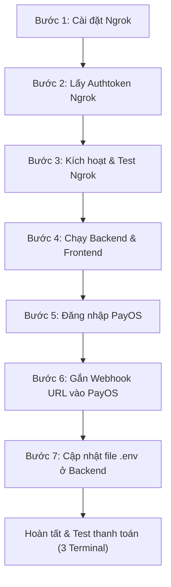

# Hướng Dẫn Cấu Hình Cổng Thanh Toán VietQR (PayOS) & MoMo Qua Ngrok

> **Mục đích tài liệu:**  
> Hướng dẫn từng bước cách thiết lập môi trường để tính năng thanh toán bằng **VietQR qua PayOS** và **MoMo** có thể hoạt động được trên máy cá nhân (`localhost`).  
> 
> *Do các cổng thanh toán cần gửi thông báo xác nhận tiền về (Webhook IPN) từ Internet về máy, nên cần sử dụng công cụ **Ngrok** để mở một đường dẫn cho Backend.*

---

## CÁC BƯỚC THỰC HIỆN



---

### Bước 1: Cài đặt Ngrok trong VS Code

Mở PowerShell trong VS Code (hoặc Terminal Windows) và chạy lệnh sau:

```powershell
winget install ngrok
```
*(Nếu máy báo lỗi không tìm thấy package, hãy chạy: `winget install Ngrok.Ngrok`)*

> Sau khi cài đặt hoàn tất, **hãy tắt hẳn VS Code rồi mở lại** để hệ thống nhận diện môi trường của Ngrok.

---

### Bước 2: Đăng ký tài khoản Ngrok trên trình duyệt

1. Truy cập trang đăng ký: [https://dashboard.ngrok.com/signup](https://dashboard.ngrok.com/signup)
2. Chọn **Continue with GitHub** (đăng nhập bằng GitHub cho nhanh và tiện).
3. Sau khi đăng nhập thành công vào trang quản trị:
   - Nhìn sang menu bên trái, bấm vào mục **Your Authtoken**.
   - Bấm nút **Copy** để lưu đoạn mã token cá nhân.

---

### Bước 3: Kích hoạt Token trên VS Code & Lấy link công khai

1. Mở Terminal trong VS Code và chạy lệnh để nạp token vừa copy:
   ```bash
   ngrok config add-authtoken <dán_mã_token_vừa_copy_vào_đây>
   ```
   *(Ví dụ: `ngrok config add-authtoken 2tABCxyz...`)*

2. Chạy thử nghiệm cho cổng **3001** (cổng chạy Backend):
   ```bash
   ngrok http 3001
   ```

3. Kiểm tra màn hình terminal:
   - Khi chạy thành công, sẽ thấy thông tin tương tự như sau:
     ```text
     Session Status    online
     Forwarding        https://cusp-pager-velvet.ngrok-free.app -> http://localhost:3001
     ```
   - Hãy **copy lại đường dẫn `https://xxxx.ngrok-free.app`** này để dùng cho Bước 6.

> [!WARNING]
> **Xử lý sự cố nếu không thấy dòng `Forwarding`:**
> - Nếu màn hình không hiện dòng Forwarding hoặc báo phiên bản đã cũ:
>   1. Nhấn `Ctrl + C` để dừng.
>   2. Chạy lệnh: `ngrok update`
>   3. Sau đó chạy lại: `ngrok http 3001`

---

### Bước 4: Khởi động Backend và Frontend

Mở thêm 2 tab Terminal mới trong VS Code:
1. **Terminal chạy Backend:**
   ```bash
   cd backend
   npm run start:dev
   ```
2. **Terminal chạy Frontend:**
   ```bash
   cd frontend
   npm run dev
   ```
*(Nếu trên trình duyệt mở ra trang thông báo kết nối của Ngrok với mã `ERR_NGROK_8012`, chỉ cần tắt tab đó đi sau khi Backend đã khởi chạy thành công).*

---

### Bước 5: Đăng nhập vào trang quản trị PayOS

1. Mở trình duyệt và truy cập: [https://payos.vn](https://payos.vn)
2. Đăng nhập với tài khoản kiểm thử của nhóm:
   - **Tên đăng nhập (Email):** `thanhle502188@gmail.com`
   - **Mật khẩu:** `Cnpm_nhom06@`

> [!NOTE]
> Nếu hệ thống PayOS yêu cầu mã OTP gửi về điện thoại / email, hãy nhắn tin ngay cho bạn **Thành Lê** trong nhóm để nhận mã OTP.

---

### Bước 6: Cấu hình Webhook URL trên PayOS

1. Sau khi vào dashboard PayOS, nhìn menu bên trái và click vào **Kênh thanh toán**.
2. Chọn kênh thanh toán tên là **BrewLite**.
3. Bấm vào nút **Cài đặt** (hoặc icon Chỉnh sửa thông tin kênh thanh toán).
4. Tìm ô nhập **Webhook URL**:
   - Lấy đường dẫn `Forwarding` đã nhận được ở **Bước 3** (ví dụ: `https://cusp-pager-velvet.ngrok-free.dev`).
   - Thêm phần đuôi `/api/payments/payos-webhook` vào sau link đó.
   - **Ví dụ hoàn chỉnh:**
     ```text
     https://cusp-pager-velvet.ngrok-free.dev/api/payments/payos-webhook
     ```
   - Dán URL hoàn chỉnh này vào ô **Webhook URL** rồi bấm **Lưu**.

---

### Bước 7: Cập nhật file `.env` ở Backend

1. Tại trang **Kênh thanh toán** > **BrewLite** trên PayOS, tìm phần **Thông tin cấu hình**.
2. Bấm vào biểu tượng con mắt để hiển thị và copy 3 giá trị:
   - `Client ID`
   - `Api Key`
   - `Checksum Key`
3. Mở file `backend/.env` (nằm trong thư mục `Assignment/backend/`):
   - Cập nhật các khóa của PayOS và dán thêm cấu hình của MoMo bên dưới:

```env
# ==========================================
# CẤU HÌNH PAYOS (VIETQR)
# ==========================================
PAYOS_CLIENT_ID="<dán_Client_ID_từ_PayOS_vào_đây>"
PAYOS_API_KEY="<dán_Api_Key_từ_PayOS_vào_đây>"
PAYOS_CHECKSUM_KEY="<dán_Checksum_Key_từ_PayOS_vào_đây>"

# ==========================================
# CẤU HÌNH VÍ MOMO (MÔI TRƯỜNG TEST / SANDBOX)
# ==========================================
MOMO_PARTNER_CODE="MOMO"
MOMO_ACCESS_KEY="F8BBA842ECF85"
MOMO_SECRET_KEY="K951B6PE1waDMi640xX08PD3vg6EkVlz"
MOMO_API_URL="https://test-payment.momo.vn/v2/gateway/api/create"
```

4. Lưu file `.env` lại.

---

## 🎯 QUY TRÌNH CHẠY KHI DEMO / TEST THANH TOÁN

> Để thanh toán thành công và đơn hàng tự động đổi từ trạng thái **`PENDING`** sang **`PAID`**, **BẮT BUỘC PHẢI CHẠY ĐỒNG THỜI 3 TERMINAL SAU ĐÂY:**

| Thứ tự Terminal | Nơi mở lệnh | Câu lệnh chạy | Mục đích |
| :---: | :--- | :--- | :--- |
| **Terminal 1** | Thư mục `Assignment/` | `ngrok http 3001` | Mở link công khai nhận Webhook từ ngân hàng / MoMo |
| **Terminal 2** | Thư mục `backend/` | `npm run start:dev` | Khởi chạy máy chủ Backend NestJS |
| **Terminal 3** | Thư mục `frontend/` | `npm run dev` | Khởi chạy giao diện người dùng Next.js |