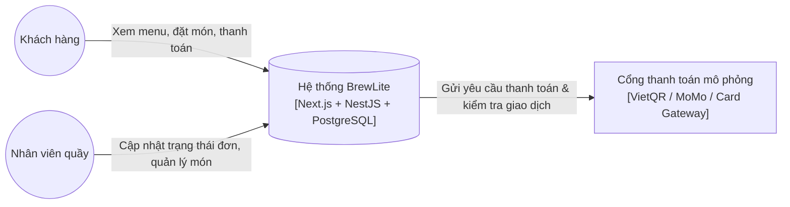

# Kiến Trúc Hệ Thống BrewLite (BrewLite System Architecture)

> **Dự án**: BrewLite – Coffee Ordering System  
> **Học phần**: Công nghệ Phần mềm (Software Engineering) – Assignment 2  
> **Phiên bản**: 1.0  
> **Tài liệu tham chiếu**: [`srs.md`](../requirements/srs.md), [`context-and-scope.md`](../requirements/context-and-scope.md), [`usecase-checkout.md`](../requirements/usecase-checkout.md)  
> **Bộ quyết định kiến trúc (ADR)**: Xem thư mục [`docs/architecture/adr/`](./adr/)

---

## 1. Tổng quan phương pháp thiết kế kiến trúc

Hệ thống **BrewLite** được thiết kế dựa trên kết hợp giữa **Mô hình C4 (C4 Model)** để trực quan hóa kiến trúc theo các mức trừu tượng khác nhau, và **Kiến trúc phân lớp theo miền (Domain-Driven Modular Layered Architecture)** nhằm đảm bảo tính phân tách trách nhiệm (Separation of Concerns), dễ kiểm thử (Testability), và dễ mở rộng (Maintainability).

```mermaid
graph TD
    subgraph Client Tier
        Browser["Khách hàng / Barista (Mobile Web / PWA)"]
    end

    subgraph Presentation Tier
        NextJS["Next.js Web Frontend (Port 3000)<br>Tailwind CSS | Zustand Store | Axios"]
    end

    subgraph Application Tier
        NestJS["NestJS Backend API (Port 3001)<br>Modular Monolith | TypeScript | Nest Pipes & Guards"]
        subgraph NestJS Core Modules
            AuthMod["AuthModule (JWT & RBAC)"]
            ProdMod["Products & Toppings Module"]
            OrderMod["Orders Module (Tx & Optimistic Lock)"]
            PayMod["Payments Module (Idempotency Key)"]
        end
    end

    subgraph Data & Integration Tier
        Postgres[(PostgreSQL Database<br>Port 5432 | Prisma ORM)]
        PaymentMock["Mock Payment Provider<br>(VietQR / MoMo / Wallet Gateway)"]
    end

    Browser -->|HTTPS / WSS| NextJS
    NextJS -->|REST API calls / JSON| NestJS
    NestJS --> AuthMod & ProdMod & OrderMod & PayMod
    OrderMod -->|Prisma Client Tx| Postgres
    PayMod -->|HTTP Request / Webhook| PaymentMock
    PayMod -->|Record Payment| Postgres
```

---

## 2. Mô hình C4 (The C4 Model for Software Architecture)

### 2.1. Level 1: System Context Diagram (Ngữ cảnh hệ thống)
Mô tả sự tương tác giữa các tác nhân (Actors) bên ngoài và hệ thống BrewLite cùng các dịch vụ tích hợp bên ngoài.

* **Actors:**
  * **Customer (Khách hàng):** Duyệt thực đơn đồ uống, tùy biến kích cỡ/topping, quản lý giỏ hàng, đặt hàng và thanh toán trực tuyến, theo dõi tiến độ pha chế và tích điểm thưởng.
  * **Barista / Staff (Nhân viên pha chế):** Tiếp nhận đơn hàng theo thời gian thực, cập nhật trạng thái đơn (`PREPARING`, `READY`, `COMPLETED`), bật/tắt trạng thái hết hàng của nguyên liệu/topping.
* **External Systems:**
  * **Payment Service / Mock Gateway:** Cung cấp cổng giả lập thanh toán qua Thẻ (Card), Ví điện tử (Wallet/MoMo) hoặc mã VietQR.



---

### 2.2. Level 2: Container Diagram (Các khối chứa - Containers)
Phân rã hệ thống BrewLite thành các ứng dụng và kho dữ liệu thực thi độc lập:

| Container | Công nghệ | Nhiệm vụ chính | Giao thức / Port |
| :--- | :--- | :--- | :--- |
| **Web Application (PWA)** | Next.js 14 (React, TypeScript, TailwindCSS) | Giao diện người dùng Mobile-first, hiển thị danh mục, giỏ hàng, tạo mã QR thanh toán, giao diện tiếp nhận đơn cho Barista. | HTTP/HTTPS (Port 3000) |
| **API Application** | NestJS 10 (Node.js, TypeScript, Express) | Cung cấp RESTful API, xác thực JWT, xử lý logic nghiệp vụ, quản lý transaction cơ sở dữ liệu. | HTTP/HTTPS (Port 3001 / 5000) |
| **Database** | PostgreSQL 15+ | Lưu trữ quan hệ: Users, Products, Toppings, Orders, OrderItems, Payments, Categories. | TCP/IP (Port 5432) |
| **Mock Payment Service** | NestJS Payment Subsystem / Mock Gateway | Giả lập quá trình sinh mã QR, xác nhận thanh toán tức thì và đối soát Idempotency Key. | HTTP Internal/External |

---

### 2.3. Level 3: Component Diagram (Phân rã Backend NestJS)
Backend được xây dựng theo mô hình **Modular Monolith** với các module nghiệp vụ tách biệt:

1. **`AuthModule`**:
   * `AuthController`: Tiếp nhận yêu cầu `POST /api/auth/register`, `POST /api/auth/login`, `GET /api/auth/me`.
   * `AuthService`: Băm mật khẩu (bcrypt), kiểm tra thông tin đăng nhập, cấp phát JWT Token.
   * `JwtAuthGuard` & `RolesGuard`: Chặn và xác thực token trên các endpoint yêu cầu quyền hạn (`customer` hoặc `barista`).
2. **`ProductsModule` & `CategoriesModule` & `ToppingsModule`**:
   * Quản lý dữ liệu danh mục, đồ uống, giá theo kích cỡ (S/M/L) và topping đi kèm.
   * Cung cấp API bật/tắt tính khả dụng (`isAvailable`, `stock`) của món khi hết hàng.
3. **`OrdersModule`**:
   * `OrdersController`: Tiếp nhận đặt đơn, lấy danh sách lịch sử đơn, cập nhật trạng thái đơn hàng.
   * `OrdersService`: Xử lý **Database Transaction** (Prisma `$transaction`), tính tổng tiền, khóa lạc quan (Optimistic Locking thông qua trường `version` trong bảng `Product`) để tránh xung đột trừ kho âm.
4. **`PaymentsModule`**:
   * `PaymentsController`: API `POST /api/payments` tiếp nhận thanh toán đơn hàng.
   * `PaymentsService`: Xử lý kiểm tra **Idempotency Key** trong header/body. Nếu key đã tồn tại, trả lại ngay kết quả của giao dịch trước đó, ngăn ngừa trừ tiền trùng lặp.
5. **`PrismaModule`**:
   * Bao bọc `PrismaClient` dưới dạng Singleton Service cung cấp kết nối database an toàn và lifecycle hook (kết nối khi khởi động, đóng kết nối khi tắt server).

---

## 3. Các thành phần kỹ thuật chi tiết

### 3.1. Frontend: Next.js Mobile-First & PWA
* **Thiết kế Mobile-First**: Giao diện tối ưu hóa trải nghiệm một tay trên thiết bị di động, hỗ trợ vuốt chạm, sticky footer cho giỏ hàng và thanh toán nhanh.
* **Progressive Web App (PWA)**: Có tệp `manifest.json` và Service Worker cho phép người dùng cài đặt icon ứng dụng lên màn hình chính điện thoại (Add to Home Screen), tối ưu hóa bộ nhớ đệm hình ảnh món ăn để tải trang dưới 1.5 giây.
* **State Management**: Sử dụng Zustand lưu trữ trạng thái giỏ hàng (`useCartStore`) phía client, đồng bộ với `LocalStorage` giúp không bị mất đơn khi refresh trang.

### 3.2. Backend: NestJS Modular Monolith
* **Dependency Injection (DI)**: Tất cả service và repository được quản lý qua Nest IoC Container, giúp việc viết Mock Unit Test và Integration Test trở nên độc lập và dễ dàng.
* **Data Transfer Object (DTO) & Validation**: Sử dụng `class-validator` và `ValidationPipe` toàn cục (`transform: true, whitelist: true, forbidNonWhitelisted: true`) để lọc sạch payload dữ liệu trước khi đi vào logic xử lý.

### 3.3. Cơ sở dữ liệu PostgreSQL & Cơ chế Migration (Prisma ORM)
* **Schema as Code**: Toàn bộ cấu trúc cơ sở dữ liệu được định nghĩa duy nhất tại `backend/prisma/schema.prisma`.
* **Cơ chế Migration tự động**:
  * Phát triển local: Sử dụng `prisma migrate dev --name <migration_name>` tạo các tệp SQL migration có đánh số thứ tự thời gian trong thư mục `prisma/migrations`.
  * Môi trường CI/Production: Tự động chạy `prisma migrate deploy` trước khi ứng dụng khởi chạy để đồng bộ schema mà không làm mất dữ liệu.
* **Khóa lạc quan (Optimistic Concurrency Control)**: Bảng `Product` lưu trường `version Int @default(0)`. Khi đơn hàng được tạo, câu truy vấn cập nhật kho kiểm tra điều kiện `WHERE id = :id AND version = :currentVersion`. Nếu phiên bản thay đổi (do khách khác mua trước), giao dịch bị rollback và yêu cầu người dùng thử lại.

### 3.4. Dịch vụ thanh toán mô phỏng (Payment Simulation) & Idempotency Key
* **Cơ chế Idempotency Key**:
  * Mỗi lần bấm nút "Xác nhận thanh toán" tại giao diện, Client sinh một mã UUID ngẫu nhiên gắn vào `idempotencyKey`.
  * Backend kiểm tra bảng `Payment`: nếu đã có bản ghi chứa `idempotencyKey` tương ứng, hệ thống trả về ngay kết quả thanh toán trước đó (HTTP 200 OK) mà không thực hiện trừ tiền hay gọi lại cổng thanh toán.
* **Mô phỏng đa phương thức**: Hỗ trợ thanh toán bằng thẻ/ví (mô phỏng xác nhận tức thì) và tạo mã QR động (VietQR / MoMo) với cú pháp chuẩn chuyển khoản tự động.

### 3.5. Logging, Health Check & Quản lý cấu hình
* **Quản lý cấu hình**: Dùng `@nestjs/config` nạp cấu hình tập trung từ biến môi trường (`.env`), kiểm soát qua tệp mẫu `.env.example`.
* **Health Check Endpoint**: Cung cấp đường dẫn `GET /api/health` trả về trạng thái hoạt động của Service và kết nối Database (kiểm tra `SELECT 1` tới PostgreSQL).
* **Logging**: Chuẩn hóa log theo cấu trúc: `[Timestamp] [LogLevel] [Context] Message`, hỗ trợ truy vết lỗi và theo dõi các giao dịch thanh toán quan trọng.

---

## 4. Lý do chọn kiến trúc, ưu điểm, hạn chế và sự đánh đổi (Trade-offs)

| Tiêu chí | Lựa chọn của nhóm | Phương án thay thế | Lý do & Đánh đổi (Trade-off) |
| :--- | :--- | :--- | :--- |
| **Kiểu kiến trúc tổng thể** | **Modular Monolith** | Microservices Architecture | **Lý do**: Phạm vi ứng dụng BrewLite ở mức vừa phải (SME). Kiến trúc Modular Monolith cho phép phát triển nhanh, kiểm thử dễ dàng, triển khai đơn giản trên 1 container, không tốn tài nguyên quản lý mạng và service mesh phức tạp.<br>**Đánh đổi**: Toàn bộ backend chia sẻ chung tiến trình chạy; nếu một module gặp lỗi nghiêm trọng (crash bộ nhớ) có thể ảnh hưởng cả tiến trình. |
| **Framework Backend** | **NestJS (TypeScript)** | Express.js thuần / Fastify | **Lý do**: NestJS cung cấp cấu trúc module chặt chẽ, Dependency Injection, chuẩn hóa DTO validation, rất phù hợp làm việc nhóm nhiều người.<br>**Đánh đổi**: Boilerplate code nhiều hơn so với viết Express thuần. |
| **ORM / Quản lý Database** | **Prisma ORM** | TypeORM / Raw SQL | **Lý do**: Prisma tự động sinh Type-safe client, cú pháp truy vấn trực quan, hệ thống migration tự động rất tin cậy.<br>**Đánh đổi**: Truy vấn phức tạp nhiều tầng có thể kém linh hoạt hơn so với viết Query Builder hoặc Raw SQL. |
| **Giao thức thanh toán** | **Mock Gateway + Idempotency** | Tích hợp cổng thật (VNPay/ZaloPay Sandbox) | **Lý do**: Môi trường học tập không phụ thuộc vào IP tĩnh hoặc chứng chỉ doanh nghiệp của bên thứ ba, đồng thời kiểm soát hoàn toàn 100% các ca kiểm thử thành công, thất bại và timeout. |

---

## 5. Danh mục các quyết định kiến trúc (Architecture Decision Records - ADR)

Chi tiết các quyết định được tài liệu hóa thành các tệp độc lập:
1. [`001-monorepo.md`](./adr/001-monorepo.md): Quyết định tổ chức mã nguồn dạng Monorepo thống nhất.
2. [`002-modular-monolith-nestjs.md`](./adr/002-modular-monolith-nestjs.md): Quyết định lựa chọn kiến trúc Modular Monolith trên nền NestJS.
3. [`003-postgresql-and-prisma-migration.md`](./adr/003-postgresql-and-prisma-migration.md): Quyết định sử dụng PostgreSQL và cơ chế Schema Migration bằng Prisma ORM.
4. [`004-payment-simulation-and-idempotency.md`](./adr/004-payment-simulation-and-idempotency.md): Quyết định thiết kế cổng thanh toán mô phỏng và cơ chế Idempotency Key.
5. [`005-jwt-stateless-authentication.md`](./adr/005-jwt-stateless-authentication.md): Quyết định xác thực phân quyền qua JWT Token không lưu trạng thái (Stateless).
6. [`006-logging-healthcheck-and-configuration.md`](./adr/006-logging-healthcheck-and-configuration.md): Quyết định chuẩn hóa giám sát sức khỏe hệ thống, ghi log và quản lý cấu hình.
