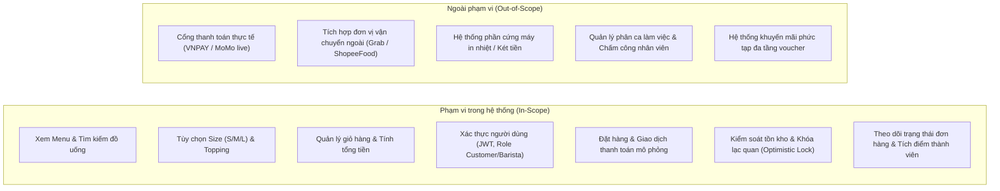

# Bối Cảnh, Stakeholder và Phạm Vi Hệ Thống (Context & Scope)

> **Dự án**: BrewLite – Coffee Ordering System  
> **Học phần**: Công nghệ Phần mềm (Software Engineering) – Assignment 2  
> **Phiên bản**: 1.0  
> **Ngày lập**: 20/10/2026  

---

## 1. Bối cảnh & Vấn đề nghiệp vụ (Business Context & Problem Statement)

### 1.1. Bối cảnh dự án
Trong mô hình kinh doanh quán cà phê và đồ uống hiện đại, tốc độ phục vụ, tính chính xác của đơn hàng và trải nghiệm cá nhân hóa là yếu tố để thu hút và giữ chân khách hàng. BrewLite là nền tảng quản lý và đặt đồ uống trực tuyến hướng tới trải nghiệm gọn nhẹ, nhanh chóng trên thiết bị di động (Mobile-First / PWA), kết nối trực tiếp giữa Khách hàng, Nhân viên pha chế (Barista) và Quản lý cửa hàng.

### 1.2. Vấn đề nghiệp vụ cần giải quyết (Problem Statement)
Hệ thống giải quyết các bài toán thực tế thường gặp tại cửa hàng bán lẻ truyền thống:
1. **Quá tải và chờ đợi lâu vào giờ cao điểm**: Khách hàng phải xếp hàng dài để chờ nhân viên ghi nhận món tại quầy, gây gián đoạn và giảm tỷ lệ hài lòng của khách.
2. **Sai sót trong tiếp nhận và pha chế order**: Khách hàng có nhu cầu tùy ý thay đổi yêu cầu (chọn kích cỡ Size S/M/L, chọn nhiều topping kèm theo). Việc truyền đạt trực tiếp hoặc ghi chép dễ dẫn đến nhầm lẫn, làm sai công thức gây lãng phí nguyên liệu.
3. **Thiếu tính minh bạch trong theo dõi tiến độ đơn hàng**: Khách hàng không nắm được đơn của mình đang ở giai đoạn nào (chờ thanh toán, đang pha chế, hay đã xong để lấy), dẫn đến việc tụ tập chờ đợi quanh quầy bar gây lộn xộn.
4. **Quản lý tồn kho và doanh thu phân tán**: Khó kiểm soát tồn kho tức thời (real-time stock) dẫn đến tình trạng khách đặt món nhưng thực tế đã hết hàng; thiếu cơ chế đối soát thanh toán và rủi ro đặt trùng đơn do lỗi mạng.
5. **Thiếu cơ chế gắn kết khách hàng (Customer Loyalty)**: Cửa hàng chưa có giải pháp tự động tích lũy điểm thưởng thành viên theo giá trị đơn hàng để tái thu hút khách hàng quay lại.

---

## 2. Bảng phân tích các bên liên quan (Stakeholder Matrix)

| STT | Stakeholder (Bên liên quan) | Vai trò (Role) | Mục tiêu chính (Goals) | Kỳ vọng đối với hệ thống (Expectations) | Mức độ ảnh hưởng |
| :---: | :--- | :--- | :--- | :--- | :---: |
| **1** | **Khách hàng** *(Customer)* | Người dùng đặt đồ uống tại quán hoặc mang đi qua thiết bị cá nhân (PWA /Responsive Web). | - Xem danh mục đồ uống và giá minh bạch. - Tùy chỉnh kích thước (Size) và Topping theo sở thích. - Đặt hàng, thanh toán nhanh và nhận thông báo khi đồ uống hoàn thành. - Tích lũy điểm thưởng thành viên tự động. | - Giao diện thân thiện, mượt mà trên thiết bị, tốc độ tải dưới 2 giây. - Giỏ hàng tính toán tiền chính xác kèm phí topping. - Nhận diện rõ ràng trạng thái đơn hàng (`PENDING` -> `PAID` -> `PREPARING` -> `READY` -> `COMPLETED`). - Không bị mất phiên đăng nhập đột ngột. | **Rất cao** (Trực tiếp) |
| **2** | **Nhân viên quầy / Pha chế** *(Barista / Cashier)* | Tiếp nhận đơn đặt món qua hệ thống, thực hiện pha chế theo đúng công thức và bàn giao cho khách. | - Tiếp nhận danh sách đơn hàng tức thời theo thứ tự thời gian. - Nắm rõ chi tiết từng món (Size, số lượng, danh sách topping đi kèm). - Cập nhật nhanh trạng thái pha chế để báo cho khách nhận món. | - Giao diện trực quan, dễ thao tác trên màn hình quầy. - Phản hồi trạng thái đơn hàng tức thời, tránh trùng đơn hoặc bỏ sót đơn. - Giảm thiểu tối đa việc tiếp nhận order thủ công tại quầy. | **Cao** (Trực tiếp) |
| **3** | **Quản lý cửa hàng** *(Store Manager)* | Giám sát vận hành cửa hàng, kiểm soát danh mục sản phẩm, tồn kho và doanh thu bán hàng. | - Kiểm soát chính xác số lượng tồn kho theo thời gian thực. - Cập nhật trạng thái bật/tắt món hoặc topping khi hết hàng. - Theo dõi dòng tiền và báo cáo lịch sử đơn hàng minh bạch. | - Hệ thống cảnh báo tự động khi sản phẩm hết hàng hoặc ngừng kinh doanh (`inactive`). - Dữ liệu tài chính nhất quán, bảo mật và lưu vết giao dịch đầy đủ. | **Cao** (Trực tiếp) |
| **4** | **Giảng viên / Khách hàng nghiệm thu** *(Lecturer / Evaluator)* | Đánh giá chất lượng dự án dựa trên chuẩn quy trình công nghệ phần mềm và các tiêu chí kỹ thuật. | - Kiểm chứng việc áp dụng đúng quy trình phát triển phần mềm (Agile/Scrum qua 2 Sprint). - Đánh giá tính hoàn thiện của các tạo phẩm (SRS, Diagrams, Architecture, Code, Test, CI/CD, Production). | - Tài liệu kỹ thuật chuẩn xác, nhất quán với mã nguồn và sơ đồ thiết kế. - Hệ thống có khả năng truy vết hoàn chỉnh (Traceability Matrix). - Ứng dụng chạy ổn định trên môi trường Production có HTTPS công khai. | **Rất cao** (Quyết định nghiệm thu) |
| **5** | **Nhóm phát triển** *(Development Team)* | Thiết kế kiến trúc, hiện thực hóa mã nguồn (Frontend, Backend, Database), viết test và cấu hình CI/CD. | - Xây dựng hệ thống module hóa, dễ mở rộng, mã nguồn sạch sẽ. - Đảm bảo độ tin cậy thông qua kiểm thử tự động (Unit, Integration, E2E). - Tự động hóa quy trình đóng gói và triển khai qua CI/CD pipeline. | - Cấu trúc thư mục monorepo/multi-apps rõ ràng. - Cơ chế migration dữ liệu nhất quán với Prisma ORM. - Dễ dàng chạy và tái tạo môi trường local qua Docker Compose. | **Cao** (Trực tiếp) |
| **6** | **Đơn vị thanh toán** *(Payment Provider - Mock)* | Thành phần dịch vụ tài chính cung cấp API xử lý thanh toán giao dịch (mô phỏng Ví điện tử / Thẻ). | - Xử lý trừ tiền và xác thực giao dịch an toàn. - Ngăn chặn gian lận hoặc thanh toán trùng lặp (Idempotency). | - Phản hồi kết quả thanh toán chính xác (`SUCCESS` hoặc `FAILED`). - Có cơ chế Idempotency Key để xử lý an toàn khi client bị rớt mạng và gửi lại request. | **Trung bình** (Tích hợp) |

---

## 3. Phạm vi hệ thống (Scope of the System)

### 3.1. Phạm vi thực hiện trong dự án (In-Scope)

#### A. Phạm vi cốt lõi (MVP - Minimum Viable Product - Sprint 1)
- **Danh mục đồ uống (Menu Browsing)**: 
  - Khách hàng xem danh sách đồ uống kèm hình ảnh, giá cơ bản, mô tả và tình trạng còn hàng.
  - Xem chi tiết từng món (`GET /products`, `GET /products/:id`).
  - Giao diện đáp ứng (Responsive) theo quy trình Mobile-First, xử lý đầy đủ trạng thái: Loading, Empty data, Error.
- **Dữ liệu mẫu & Quản lý Schema**: 
  - Tạo cấu trúc bảng ban đầu và nạp dữ liệu mẫu (Database Seeding) cho sản phẩm và người dùng.

#### B. Phạm vi hoàn thiện hệ thống (Sprint 2)
- **Tùy biến món & Giỏ hàng**:
  - Chọn kích cỡ sản phẩm (Size S, M, L với mức điều chỉnh giá tương ứng).
  - Chọn thêm danh sách các loại Topping (trân châu, thạch, kem phô mai,...).
  - Quản lý giỏ hàng cục bộ: thêm món, tăng/giảm số lượng, xóa món, tự động tính tổng tiền chính xác.
- **Xác thực & Phân quyền (Authentication & Authorization)**:
  - Đăng ký, đăng nhập tài khoản khách hàng, mã hóa mật khẩu an toàn với `bcrypt`.
  - Cấp phát và xác thực phiên làm việc bằng JSON Web Token (JWT).
  - Phân quyền theo vai trò (`customer` đặt hàng; `barista` cập nhật trạng thái đơn).
- **Quy trình Đặt hàng & Thanh toán (Checkout & Payment)**:
  - Tạo đơn hàng kèm danh sách chi tiết các món và topping tương ứng trong một Transaction an toàn.
  - Trừ số lượng tồn kho sản phẩm, áp dụng cơ chế khóa lạc quan (Optimistic Locking qua trường `version`) để chống Race Condition khi đặt hàng cùng lúc.
  - Thanh toán mô phỏng hỗ trợ 2 phương thức: Ví điện tử (`WALLET`) hoặc Thẻ tín dụng/ghi nợ (`CARD`).
  - Hỗ trợ cơ chế **Idempotency Key** (`idempotencyKey`) để đảm bảo một yêu cầu thanh toán không bao giờ bị trừ tiền hai lần khi người dùng bấm liên tiếp hoặc mạng bị chập chờn.
- **Theo dõi đơn hàng & Điểm thưởng**:
  - Khách hàng theo dõi trạng thái đơn hàng theo thời gian thực (`PENDING` -> `PAID` -> `PREPARING` -> `READY` -> `COMPLETED`).
  - Lịch sử các đơn hàng đã đặt.
  - Tự động cộng điểm khách hàng thân thiết (`loyaltyPoints`) tương ứng với giá trị đơn hàng thành công.
- **Kiểm thử & Triển khai liên tục (CI/CD)**:
  - Viết Unit test cho nghiệp vụ quan trọng, Integration test cho API đặt hàng/thanh toán, E2E test cho luồng mua hàng.
  - Pipeline GitHub Actions tự động kiểm tra Lint, Test, Build.
  - Đóng gói container Docker và triển khai lên môi trường Production có HTTPS.

### 3.2. Phạm vi mở rộng (Future Scope)
- Tính năng thông báo đẩy (Web Push Notifications / WebSocket) khi đơn hàng chuyển sang trạng thái sẵn sàng nhận món (`READY`).
- Đánh giá và bình luận sản phẩm sau khi hoàn tất đơn hàng.
- Báo cáo thống kê nâng cao theo biểu đồ doanh thu ngày/tuần/tháng dành cho quản lý.

### 3.3. Ngoài phạm vi thực hiện (Out-of-Scope)
Để tập trung tối đa vào kiến trúc kỹ thuật và luồng cốt lõi theo thời gian của đồ án môn học, các tính năng sau **không** thực hiện trong phạm vi Assignment 2:
1. **Kết nối cổng thanh toán thật**: Không tích hợp trực tiếp với cổng thanh toán ngoài (như Sandbox/Live của MoMo, VNPAY, ZaloPay, Stripe) mà sử dụng Payment Service mô phỏng nội bộ.
2. **Giao hàng đường dài (Delivery integration)**: Không tích hợp API định vị GPS hay các dịch vụ giao vận thứ ba (GrabExpress, Ahamove). Khách hàng nhận món trực tiếp tại quầy của quán (Pick-up at Store).
3. **Phần cứng quầy POS vật lý**: Không hỗ trợ kết nối phần cứng máy in bill nhiệt ESC/POS, máy quẹt thẻ POS cầm tay hoặc két tiền tự động.
4. **Quản lý nhân sự và ca kíp**: Không xây dựng phân hệ tính lương, chấm công hay xếp lịch ca làm việc cho nhân viên.

---

## 4. Các giả định & Ràng buộc (Assumptions & Constraints)

### 4.1. Giả định (Assumptions)
1. **Thiết bị người dùng**: Người dùng (khách hàng) sở hữu thiết bị thông minh có trình duyệt web hiện đại hỗ trợ JavaScript, HTML5 và kết nối mạng Internet ổn định.
2. **Quy mô kinh doanh ban đầu**: Hệ thống phục vụ cho một cửa hàng cà phê đơn lẻ (Single Store) với lưu lượng truy cập mức vừa phải (dưới 100 giao dịch đồng thời trong giờ cao điểm).
3. **Thanh toán**: Khách hàng luôn có đủ số dư khi chọn phương thức thanh toán ví hợp lệ trong kịch bản kiểm thử luồng chuẩn.
4. **Môi trường vận hành**: Giảng viên và người chấm bài có thể truy cập được các URL public (frontend và backend) thông qua giao thức HTTPS.

### 4.2. Ràng buộc kỹ thuật (Technical Constraints)
1. **Ràng buộc công nghệ bắt buộc (Theo yêu cầu đề bài)**:
   - **Frontend**: Next.js theo định hướng Mobile-first / PWA.
   - **Backend**: NestJS kiến trúc module/domain hướng dịch vụ.
   - **Database**: PostgreSQL (quản trị schema và migration thông qua Prisma ORM).
   - **Containerization**: Ứng dụng phải được đóng gói bằng Docker và khởi chạy đồng bộ bằng `docker-compose`.
2. **Ràng buộc giao thức & bảo mật**:
   - Giao tiếp giữa Client và Server sử dụng RESTful API chuẩn JSON qua giao thức HTTPS.
   - Các API như: tạo đơn, thanh toán, xem lịch sử, đổi trạng thái, bắt buộc phải có Bearer Token JWT hợp lệ.
   - Mật khẩu người dùng bắt buộc được mã hóa một chiều bằng thuật toán `bcrypt` trước khi lưu vào cơ sở dữ liệu.
3. **Ràng buộc toàn vẹn dữ liệu (Data Integrity)**:
   - Thao tác tạo đơn hàng, trừ kho sản phẩm và tạo bản ghi thanh toán phải nằm trong một Database Transaction (Atomic). Nếu một bước gặp sự cố, toàn bộ giao dịch phải được Rollback.
   - Cơ chế phòng chống Race Condition khi trừ kho sản phẩm bằng trường `version` (Optimistic Concurrency Control).

---

## 5. Đánh giá rủi ro ban đầu (Initial Risk Assessment)

| STT | Rủi ro (Risk) | Khả năng xảy ra | Mức độ tác động | Giải pháp giảm thiểu (Mitigation Strategy) |
| :---: | :--- | :---: | :---: | :--- |
| **R-01** | **Bán vượt tồn kho (Overselling)**: Nhiều khách hàng cùng đặt sản phẩm cuối cùng tại một thời điểm dẫn đến số lượng tồn kho bị âm. | Trung bình | Rất cao | Áp dụng kỹ thuật khóa lạc quan (Optimistic Locking) với trường `version` trong bảng `Product`. Giao dịch nào bị trùng version sẽ bị hủy và thông báo cho người dùng mua sau. |
| **R-02** | **Thanh toán trùng lặp (Double Payment)**: Người dùng nhấn nút thanh toán nhiều lần do mạng lag hoặc gửi lại request khi kết nối bị chập chờn. | Cao | Nghiêm trọng | Thiết kế header hoặc body có `idempotencyKey` duy nhất cho mỗi phiên thanh toán. Backend kiểm tra nếu key đã xử lý thì trả về kết quả cũ mà không trừ tiền lại. |
| **R-03** | **Lỗi xung đột Schema & Migration**: Thay đổi cấu trúc cơ sở dữ liệu không đồng nhất giữa môi trường local và môi trường production. | Trung bình | Cao | Sử dụng Prisma Migration có kiểm soát phiên bản bằng git (`prisma migrate dev` và `prisma migrate deploy`), chạy tự động trong pipeline CI/CD trước khi khởi động ứng dụng. |
| **R-04** | **Quá hạn thời gian triển khai CI/CD**: Cấu hình pipeline và deploy production gặp lỗi về môi trường hoặc secret. | Trung bình | Cao | Sử dụng nền tảng PaaS hiện đại (Render / Railway / Fly.io) có hỗ trợ sẵn Docker container, thiết lập biến môi trường qua Secret Manager an toàn và kiểm thử sớm ngay từ Sprint 1. |
