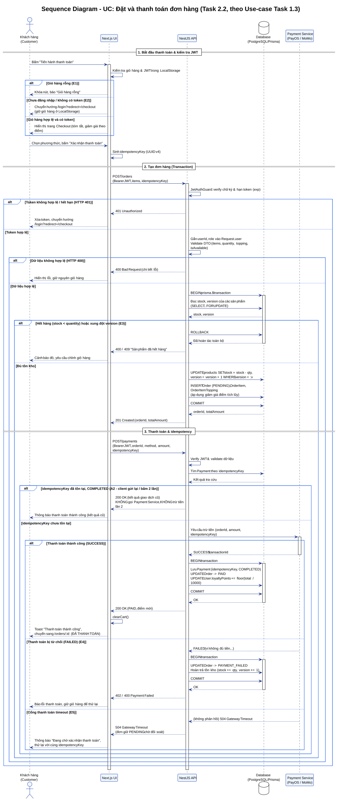

# Thiết Kế Sequence Diagram: Đặt và Thanh Toán Đơn Hàng (Task 2.2)

> **Dự án**: BrewLite – Coffee Ordering System  
> **Học phần**: Công nghệ Phần mềm (Software Engineering) – Assignment 2  
> **Nhiệm vụ**: **Task 2.2 – Sequence Diagram cho Use-Case Trọng Tâm (Task 1.3)**  
> **Phiên bản**: 1.0 (Chuẩn UML 2.0 Quốc Tế)  
> **Tệp mã nguồn PlantUML**: [`docs/diagrams/sequence-checkout.puml`](../diagrams/sequence-checkout.puml)  
> **Tệp ảnh Vector SVG**: [`docs/diagrams/sequence-checkout.svg`](../diagrams/sequence-checkout.svg)  
> **Tệp ảnh PNG**: [`docs/diagrams/sequence-checkout.png`](../diagrams/sequence-checkout.png)  

---

## 1. Giới thiệu tổng quan

Tài liệu này hiện thực hóa **Task 2.2** trong khuôn khổ Assignment 2, mô hình hóa chi tiết trình tự tương tác thời gian thực giữa các thành phần kiến trúc hệ thống BrewLite khi thực thi Use-Case trọng tâm **"Đặt và thanh toán đơn hàng"** (đã được đặc tả tại Task 1.3).

Sơ đồ thể hiện đầy đủ:
- **5 Lifelines chuẩn kiến trúc**: `Customer` $\rightarrow$ `Next.js UI` $\rightarrow$ `NestJS API` $\rightarrow$ `Database (PostgreSQL / Prisma)` $\rightarrow$ `Payment Service (PayOS / MoMo)`.
- **Thứ tự gọi API và cấu trúc Request / Response**: Tuân thủ chuẩn RESTful API và JWT Bearer Authentication.
- **Tính toàn vẹn dữ liệu (ACID Transaction)**: Mở transaction nguyên tử kiểm tra tồn kho bằng khóa lạc quan (`version`), trừ kho và tạo đơn `PENDING`.
- **Chống trừ tiền trùng lặp (Idempotency Key)**: Kiểm tra khóa Idempotency trước khi gọi Cổng thanh toán, trả về kết quả cũ nếu trùng lặp.
- **Các nhánh xử lý điều kiện (alt blocks)**: Thanh toán thành công (`PAID`, cộng điểm `loyaltyPoints`), thanh toán thất bại (`PAYMENT_FAILED`, hoàn trả tồn kho `Stock Rollback`), và timeout mạng (`504 Gateway Timeout`).

---

## 2. Sơ đồ tương tác tuần tự (Sequence Diagram)

### 2.1. Hình ảnh trực quan

---

## 3. Các thành phần Lifelines

| Lifeline | Loại | Vai trò & Trách nhiệm trong hệ thống |
| :--- | :--- | :--- |
| **Customer** | Actor | Người dùng cuối tương tác trực tiếp trên trình duyệt, duyệt giỏ hàng, chọn phương thức và xác nhận thanh toán. |
| **Next.js UI** | Client Application | Ứng dụng Frontend (React/Next.js App Router, Zustand Store, Tailwind CSS): quản lý giỏ hàng ở LocalStorage, kiểm tra sơ bộ token, sinh `idempotencyKey` UUID v4, điều hướng màn hình. |
| **NestJS API** | Backend Service | Máy chủ ứng dụng trung tâm: xác thực JWT (`JwtAuthGuard`), validate DTO, điều phối nghiệp vụ tạo đơn, quản lý transaction CSDL và kết nối Cổng thanh toán. |
| **Database** | Persistence Layer | Cơ sở dữ liệu quan hệ PostgreSQL truy xuất qua Prisma ORM: thực thi Atomic Transaction (`$transaction`), kiểm soát tồn kho (`stock`), khóa lạc quan (`version`), lưu trữ đơn hàng và thông tin thanh toán. |
| **Payment Service** | External Gateway | Cổng thanh toán trực tuyến mô phỏng (PayOS / MoMo): xử lý trừ tiền từ tài khoản/ví khách hàng, phản hồi mã giao dịch `transactionId` hoặc từ chối thanh toán. |

---

## 4. Đặc tả chi tiết các giai đoạn tương tác

### Giai đoạn 1: Bắt đầu thanh toán & Kiểm tra phiên đăng nhập (JWT)
1. **Khách hàng** bấm nút *"Tiến hành thanh toán"* trên giao diện giỏ hàng.
2. **Next.js UI** kiểm tra tính hợp lệ của giỏ hàng và sự tồn tại của JWT token trong `LocalStorage`:
   - **Nhánh E1 (Giỏ hàng rỗng)**: Khóa nút thanh toán và báo lỗi.
   - **Nhánh E2 (Chưa đăng nhập / Token thiếu)**: Chuyển hướng người dùng sang trang `/login?redirect=/checkout`, lưu giữ nguyên giỏ hàng.
   - **Nhánh Hợp lệ**: Mở trang Checkout hiển thị tóm tắt đơn hàng và điểm tích lũy thành viên.
3. **Khách hàng** chọn phương thức thanh toán (`WALLET` / `CARD`) và bấm *"Xác nhận thanh toán"*.
4. **Next.js UI** sinh chuỗi ngẫu nhiên `idempotencyKey` (chuẩn UUID v4).

### Giai đoạn 2: Tạo đơn hàng và Trừ tồn kho trong Atomic Database Transaction
1. **Next.js UI** gửi yêu cầu `POST /orders` kèm Bearer JWT Token, danh sách sản phẩm (`items`) và `idempotencyKey`.
2. **NestJS API** thực thi `JwtAuthGuard` để verify chữ ký và hạn dùng của token:
   - Nếu token sai hoặc hết hạn $\rightarrow$ Trả về `401 Unauthorized`.
3. Khi token hợp lệ, NestJS trích xuất `userId`, `role` gán vào context `Request.user`, đồng thời validate DTO:
   - Dữ liệu lỗi $\rightarrow$ Trả về `400 Bad Request`.
4. Khi dữ liệu hợp lệ, NestJS API mở Transaction nguyên tử: `BEGIN prisma.$transaction`:
   - Truy vấn tồn kho hiện tại: `SELECT stock, version FROM products WHERE id IN (...) FOR UPDATE`.
   - **Nhánh E3 (Hết hàng hoặc xung đột version)**: `ROLLBACK` transaction 100%, trả về `400 / 409 Conflict`.
   - **Nhánh Đủ tồn kho**: Cập nhật trừ kho và tăng `version` (`stock = stock - qty, version = version + 1`), chèn bản ghi `Order` ở trạng thái `PENDING` cùng các bản ghi `OrderItem`.
   - `COMMIT` transaction, trả về `201 Created` kèm `orderId` và `totalAmount`.

### Giai đoạn 3: Xử lý thanh toán, Idempotency và Đồng bộ kết quả
1. **Next.js UI** tiếp tục gửi yêu cầu `POST /payments` kèm `orderId`, `method`, `amount` và `idempotencyKey`.
2. **NestJS API** xác thực JWT và kiểm tra `idempotencyKey` trong Database:
   - **Nhánh A2 (Idempotency Key đã tồn tại - COMPLETED)**: Trả về ngay kết quả giao dịch cũ với `200 OK`, **tuyệt đối không gọi Cổng thanh toán lần 2** và không trừ tiền lặp lại.
   - **Nhánh Idempotency Key chưa tồn tại**: Chuyển tiếp yêu cầu thanh toán sang Cổng thanh toán (`Payment Service`).
3. **Xử lý phản hồi từ Cổng thanh toán**:
   - **Trường hợp Thành công (SUCCESS)**: Cổng thanh toán trả về `SUCCESS` kèm `transactionId`. NestJS API mở transaction lưu bản ghi `Payment`, cập nhật `Order` sang `PAID`, tự động cộng điểm thưởng `loyaltyPoints` vào tài khoản khách hàng, trả về `200 OK`. Next.js UI gọi `clearCart()` và điều hướng sang `/orders/:id`.
   - **Trường hợp Bị từ chối (FAILED - Nhánh E4)**: Cổng thanh toán trả về `FAILED`. NestJS API mở transaction cập nhật `Order` sang `PAYMENT_FAILED` và **kích hoạt Stock Rollback** hoàn trả lại số lượng tồn kho. UI hiển thị thông báo lỗi và bảo lưu giỏ hàng cho khách thử lại.
   - **Trường hợp Mất kết nối / Hết thời gian chờ (Gateway Timeout - Nhánh E5)**: NestJS API trả về `504 Gateway Timeout`. Đơn hàng được giữ nguyên trạng thái `PENDING` chờ đối soát. Khách hàng có thể an tâm bấm thanh toán lại với cùng mã `idempotencyKey`.

---

## 5. Bảng đối chiếu Tiêu chí chấp nhận (Acceptance Criteria Mapping)

| Mã AC | Tiêu chí kỹ thuật trong sơ đồ | Kết quả kiểm chứng trên Sequence Diagram |
| :--- | :--- | :--- |
| **AC-INT-01** | Tạo đơn trong Atomic Transaction | Thể hiện qua `BEGIN prisma.$transaction` $\rightarrow$ `UPDATE products` $\rightarrow$ `INSERT Order` $\rightarrow$ `COMMIT`. |
| **AC-INT-02** | Chống bán âm kho (Optimistic Lock) | Thể hiện qua nhánh `alt stock < quantity` $\rightarrow$ `ROLLBACK` $\rightarrow$ `400/409 Conflict`. |
| **AC-INT-03** | Chống trừ tiền trùng (Idempotency) | Thể hiện qua nhánh kiểm tra `idempotencyKey đã tồn tại` $\rightarrow$ trả về `200 OK` cũ, không gọi Payment Service. |
| **AC-INT-04** | Tích lũy điểm thưởng khi thanh toán | Thể hiện qua bước cập nhật `User.loyaltyPoints += floor(total / 10000)` trong transaction sau khi nhận `SUCCESS`. |
| **AC-INT-05** | Hoàn trả tồn kho khi thanh toán lỗi | Thể hiện qua nhánh `Payment FAILED` $\rightarrow$ `Order -> PAYMENT_FAILED` và `stock += qty, version += 1`. |
| **AC-E2E-01** | Phản hồi thông suốt cho người dùng | Toàn bộ các nhánh đều có thông điệp phản hồi rõ ràng về Next.js UI để thông báo cho Customer. |
