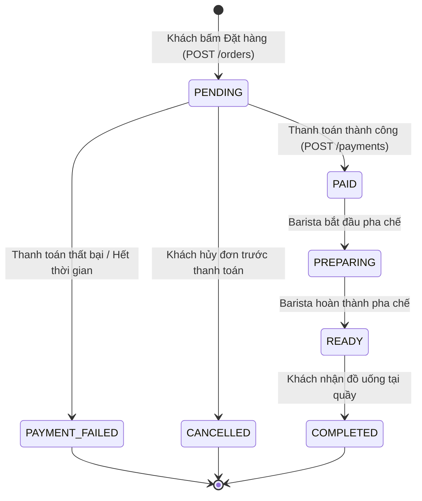

# Đặc Tả Yêu Cầu Phần Mềm Rút Gọn (Software Requirements Specification - SRS)

> **Dự án**: BrewLite – Coffee Ordering System  
> **Học phần**: Công nghệ Phần mềm (Software Engineering) – Assignment 2  
> **Mã tài liệu**: SRS-VER-1.0  
> **Ngày cập nhật**: 20/10/2026  

---

## 1. Giới thiệu tổng quan (Introduction)

Tài liệu này xác định các **Yêu cầu chức năng (Functional Requirements - FR)** và **Yêu cầu phi chức năng (Non-Functional Requirements - NFR)** cho hệ thống đặt đồ uống BrewLite. Mọi yêu cầu được phân loại mức độ ưu tiên theo mô hình **MoSCoW** (*Must have, Should have, Could have, Won't have*), đi kèm các **Tiêu chí chấp nhận (Acceptance Criteria)** có thể kiểm chứng được để làm căn cứ thiết kế kiến trúc, hiện thực mã nguồn và xây dựng bộ kiểm thử (Test Cases).

---

## 2. Sơ đồ Use-case tổng quát hệ thống (Overall Use Case Diagram)

---

## 3. Danh sách Yêu cầu Chức năng (Functional Requirements - FR)

Mức ưu tiên phân bổ theo **MoSCoW**:
- **Must (M)**: Bắt buộc phải có để hệ thống hoạt động được trong MVP (Sprint 1 và Sprint 2).
- **Should (S)**: Cần thiết để trải nghiệm người dùng hoàn chỉnh.
- **Could (C)**: Tính năng bổ trợ nếu có thêm thời gian.
- **Won't (W)**: Tạm hoãn, không triển khai trong phạm vi Assignment 2.

| Mã YC | Nhóm chức năng | Tên yêu cầu | Mô tả chi tiết | MoSCoW | Tiêu chí chấp nhận (Acceptance Criteria) |
| :---: | :--- | :--- | :--- | :---: | :--- |
| **FR-01** | **Menu** | Xem danh sách đồ uống | Khách hàng có thể xem danh mục đồ uống với hình ảnh, tên món, giá cơ sở và trạng thái còn/hết hàng. | **Must** | **AC-01.1**: Trả về danh sách sản phẩm active kèm phân trang/danh mục qua `GET /products`. **AC-01.2**: Hiển thị rõ nhãn "Hết hàng" nếu sản phẩm có `stock = 0` hoặc trạng thái `inactive`. |
| **FR-02** | **Chi tiết sản phẩm** | Xem chi tiết món & cấu hình | Khách hàng xem thông tin chi tiết món, chọn dung tích kích cỡ (Size S, M, L) và danh sách Topping đi kèm. | **Must** | **AC-02.1**: Lấy chi tiết món qua `GET /products/:id`. **AC-02.2**: Lấy danh sách topping khả dụng qua `GET /api/toppings`. **AC-02.3**: Khi đổi size (S: cơ sở, M: +5.000đ, L: +10.000đ) hoặc chọn thêm topping, tổng giá tạm tính cập nhật ngay tức thì trên giao diện. |
| **FR-03** | **Giỏ hàng** | Quản lý giỏ hàng cục bộ | Khách hàng có thể thêm món đã chọn vào giỏ, tăng/giảm số lượng, xóa món và xem tổng giá trị đơn hàng. | **Must** | **AC-03.1**: Giỏ hàng lưu trữ đúng cấu trúc: `productId, size, quantity, toppings[]`. **AC-03.2**: Cho phép chỉnh sửa số lượng ($1 \le quantity \le 99$) hoặc xóa món khỏi giỏ. **AC-03.3**: Tổng tiền đơn hàng (`total`) tính đúng công thức: $\sum ((\text{Giá size} + \sum \text{Giá topping}) \times \text{Số lượng})$. |
| **FR-04** | **Xác thực** | Đăng ký & Đăng nhập (JWT) | Người dùng đăng ký tài khoản mới bằng Email/Mật khẩu và đăng nhập để nhận Token xác thực phiên làm việc. | **Must** | **AC-04.1**: Mật khẩu mã hóa một chiều an toàn bằng thư viện `bcrypt`. **AC-04.2**: Đăng ký từ chối nếu Email đã tồn tại trong hệ thống. **AC-04.3**: Đăng nhập thành công trả về `accessToken` JWT chứa `userId` và `role` (`customer` hoặc `barista`). Token có thời hạn hợp lệ. |
| **FR-05** | **Đặt đơn hàng** | Tạo đơn hàng mới | Khách hàng gửi thông tin giỏ hàng để tạo đơn hàng mới, kiểm tra tồn kho và chuyển trạng thái sang `PENDING`. | **Must** | **AC-05.1**: API `POST /orders` yêu cầu Bearer Token JWT. **AC-05.2**: Toàn bộ quá trình tạo `Order`, các bản ghi `OrderItem`, `OrderItemTopping` và trừ số lượng `stock` của `Product` phải nằm trong một Database Transaction (Atomic). **AC-05.3**: Áp dụng kiểm tra xung đột tồn kho (Optimistic Concurrency Control qua cột `version`). Báo lỗi `400 Bad Request` nếu không đủ hàng tồn. |
| **FR-06** | **Thanh toán** | Thanh toán đơn hàng mô phỏng | Khách hàng thực hiện thanh toán cho đơn hàng `PENDING` bằng phương thức Ví điện tử (`WALLET`) hoặc Thẻ (`CARD`). | **Must** | **AC-06.1**: API `POST /payments` nhận `orderId`, `method`, `amount` và `idempotencyKey`. **AC-06.2**: Nếu `idempotencyKey` đã tồn tại, hệ thống trả về kết quả thanh toán cũ mà không thực hiện trừ tiền hay thay đổi trạng thái lần 2. **AC-06.3**: Thanh toán thành công cập nhật trạng thái đơn thành `PAID`. Thanh toán thất bại chuyển đơn sang `PAYMENT_FAILED`. |
| **FR-07** | **Lịch sử & Điểm** | Xem lịch sử đơn & Tích điểm | Khách hàng xem danh sách các đơn hàng đã mua và số điểm thưởng thành viên tích lũy hiện có. | **Should** | **AC-07.1**: API `GET /orders` lọc theo `userId` của tài khoản đang đăng nhập. **AC-07.2**: Mỗi đơn hàng thanh toán thành công (`PAID`) tự động cộng điểm tích lũy: $10.000\text{ VNĐ} = 1\text{ điểm}$ vào trường `loyaltyPoints` của `User`. |
| **FR-08** | **Quản lý đơn** | Cập nhật tiến độ pha chế | Nhân viên quầy / Pha chế (Barista) xem danh sách các đơn `PAID` và cập nhật lần lượt sang `PREPARING`, `READY`, `COMPLETED`. | **Must** | **AC-08.1**: API `PATCH /orders/:id/status` chỉ cho phép người dùng có `role = barista` truy cập. **AC-08.2**: Chuyển trạng thái đơn tuần tự theo đúng quy tắc FSM (Finite State Machine). Không cho phép nhảy cóc trạng thái bất hợp lệ (ví dụ: từ `PENDING` nhảy thẳng lên `COMPLETED`). |
| **FR-09** | **Quản lý món** | Bật/tắt món & topping | Quản lý hoặc nhân viên có thể bật/tắt khả dụng của sản phẩm hoặc topping khi quán tạm hết nguyên liệu. | **Should** | **AC-09.1**: Cập nhật trạng thái `isAvailable` của topping qua `PATCH /api/toppings/:id`. **AC-09.2**: Các món hoặc topping bị tắt khả dụng lập tức không xuất hiện trong danh sách lựa chọn của khách hàng. |

---

## 4. Danh sách Yêu cầu Phi Chức năng (Non-Functional Requirements - NFR)

| Mã YC | Phân loại | Tên yêu cầu | Mô tả kỹ thuật chi tiết | MoSCoW | Tiêu chí chấp nhận (Acceptance Criteria) |
| :---: | :--- | :--- | :--- | :---: | :--- |
| **NFR-01** | **Hiệu năng** *(Performance)* | Thời gian đáp ứng hệ thống | Hệ thống phản hồi nhanh chóng, hạn chế tối đa độ trễ để phục vụ tốt vào giờ cao điểm. | **Must** | **AC-NFR-01.1**: Thời gian phản hồi (Response Time) của 95% các API truy vấn (`GET /products`, `GET /api/toppings`) $< 300\text{ms}$ trong điều kiện tải bình thường. **AC-NFR-01.2**: Thời gian render trang chủ lần đầu (FCP - First Contentful Paint) trên trình duyệt mobile $< 2.0\text{s}$. |
| **NFR-02** | **Bảo mật** *(Security)* | An toàn dữ liệu & Xác thực | Bảo vệ thông tin tài khoản người dùng và ngăn chặn các lỗ hổng bảo mật phổ biến. | **Must** | **AC-NFR-02.1**: Mật khẩu người dùng được băm bằng thuật toán `bcrypt` với cost factor $\ge 10$. Tuyệt đối không lưu plain-text. **AC-NFR-02.2**: API bảo vệ bằng JWT Bearer Token, kiểm tra quyền truy cập theo Role (RBAC) để chặn truy cập trái phép. **AC-NFR-02.3**: Sử dụng Prisma ORM có Parameterized Queries giúp ngăn chặn triệt để tấn công SQL Injection. |
| **NFR-03** | **Toàn vẹn dữ liệu** *(Data Integrity)* | Xử lý tranh chấp & Chống trùng lặp | Đảm bảo tính nhất quán của dữ liệu kho và tiền tệ trong môi trường nhiều người dùng đồng thời. | **Must** | **AC-NFR-03.1**: Mọi thao tác cập nhật kho và tạo đơn phải tuân thủ chuẩn ACID thông qua `$transaction` của Prisma. **AC-NFR-03.2**: Cơ chế Optimistic Lock qua cột `version` ngăn chặn hoàn toàn hiện tượng bán âm kho (Overselling). **AC-NFR-03.3**: Trường `idempotencyKey` đảm bảo mỗi phiên giao dịch thanh toán là duy nhất (Unique Constraint). |
| **NFR-04** | **Tính khả dụng** *(Usability)* | Giao diện Mobile-first & Phản hồi lỗi | Ứng dụng web được tối ưu cho màn hình cảm ứng di động, hiển thị rõ ràng mọi trạng thái. | **Must** | **AC-NFR-04.1**: Giao diện đạt chuẩn Responsive, bố cục tối ưu cho tỷ lệ màn hình điện thoại (Mobile viewport $375\text{px} - 430\text{px}$). **AC-NFR-04.2**: 100% các màn hình tải dữ liệu đều có hiệu ứng Loading (Skeleton/Spinner), thông báo Empty khi không có dữ liệu và hiển thị lỗi thân thiện (Toast/Alert) khi có sự cố. |
| **NFR-05** | **Khả năng triển khai** *(Deployability)* | Đóng gói Container & Tự động hóa CI/CD | Hệ thống dễ dàng triển khai, vận hành độc lập và tự động hóa quy trình kiểm thử. | **Must** | **AC-NFR-05.1**: Cung cấp file `docker-compose.yml` có thể khởi động đầy đủ: Frontend, Backend API và PostgreSQL chỉ bằng một câu lệnh `docker compose up`. **AC-NFR-05.2**: Pipeline GitHub Actions tự động thực thi 4 bước: `Install -> Lint -> Unit Test -> Build` trên mỗi Pull Request và chặn merge nếu thất bại. **AC-NFR-05.3**: Cung cấp endpoint `GET /health` trả về mã `200 OK` phục vụ giám sát trạng thái hoạt động (Health check). |

---

## 5. Quy tắc chuyển đổi trạng thái đơn hàng (Order State Machine)

Hệ thống quản lý vòng đời đơn hàng theo biểu đồ chuyển trạng thái nghiêm ngặt dưới đây:

- **PENDING**: Đơn vừa tạo, chờ thực hiện thanh toán (kho đã tạm giữ thông qua transaction).
- **PAID**: Đã thanh toán tiền thành công, hệ thống cộng điểm `loyaltyPoints` cho khách.
- **PREPARING**: Nhân viên Barista đang thực hiện làm đồ uống theo công thức.
- **READY**: Thức uống đã xong, sẵn sàng ở quầy chờ khách đến lấy.
- **COMPLETED**: Khách đã nhận đồ uống, quy trình hoàn tất.
- **PAYMENT_FAILED / CANCELLED**: Đơn hàng bị hủy bỏ; hệ thống hoàn trả lại số lượng tồn kho (Rollback stock).
