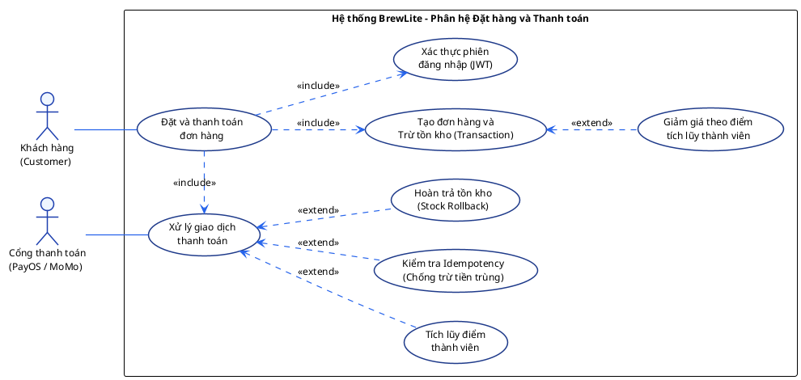
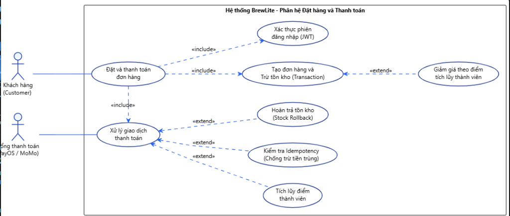

# Đặc Tả Use-Case Trọng Tâm: Đặt và Thanh Toán Đơn Hàng (Task 1.3)

> **Dự án**: BrewLite – Coffee Ordering System  
> **Học phần**: Công nghệ Phần mềm (Software Engineering) – Assignment 2  
> **Mã Use-case**: **UC-01: Đặt và thanh toán đơn hàng (Place Order & Payment)**  
> **Phiên bản**: 1.0 (Chuẩn UML 2.0 Quốc Tế)  
> **Tệp mã nguồn PlantUML**: [`docs/diagrams/usecase-checkout.puml`](../diagrams/usecase-checkout.puml)  
> **Tệp ảnh Vector SVG**: [`docs/diagrams/usecase-checkout.svg`](../diagrams/usecase-checkout.svg)  
> **Tệp ảnh PNG**: [`docs/diagrams/usecase-checkout.png`](../diagrams/usecase-checkout.png)  
> **Bản in PDF**: [`docs/requirements/usecase-checkout.pdf`](usecase-checkout.pdf)  

---

## 1. Giới thiệu & Bối cảnh nghiệp vụ

Trong hệ sinh thái BrewLite, **"Đặt và thanh toán đơn hàng"** là luồng nghiệp vụ xương sống mang lại giá trị giao dịch cốt lõi. Luồng này chuyển hóa giỏ hàng của khách hàng thành đơn hàng chính thức trong hệ thống, bảo đảm kiểm soát tồn kho tức thời (tránh bán âm kho - overselling), thanh toán an toàn qua cổng mô phỏng (hỗ trợ chống trừ trùng lặp - idempotency), và kích hoạt quy trình pha chế cho nhân viên quầy (Barista).

---

## 2. Sơ đồ Use-case chuẩn UML 2.0 Quốc Tế

### 2.1. Quy tắc thiết kế chuẩn UML (OMG Specification)
1. **Actor chuẩn thế giới**: Tất cả tác nhân đều được vẽ bằng **hình người que (Stick figure)** (`Customer` và `Payment Service`).
2. **Use Case**: Thể hiện bằng **hình elip (oval/ellipse)** nằm ngang.
3. **Biên giới hệ thống (System Boundary)**: Hình chữ nhật bao trùm phân hệ nghiệp vụ cần mô hình hóa.
4. **Quan hệ `<<include>>` (Bắt buộc)**: Mũi tên nét đứt hướng từ **Base Use Case $\rightarrow$ Included Use Case**. Nếu không có use-case con này, use-case cha không thể hoàn tất.
5. **Quan hệ `<<extend>>` (Mở rộng có điều kiện)**: Mũi tên nét đứt hướng từ **Extension Use Case $\rightarrow$ VỀ Base Use Case** (Đúng chuẩn OMG UML: Base không biết trước ai extend nó, Extension trỏ về Base kèm điểm mở rộng / Extension Point).

### 2.2. Mã nguồn PlantUML chuẩn (`docs/diagrams/usecase-checkout.puml`)

### 2.3. Sơ đồ hình ảnh trực quan

---

## 3. Đặc tả chi tiết từng Use-Case (Đánh số tuần tự từ UC-01 đến UC-08)

Dưới đây là bảng đặc tả chi tiết cho toàn bộ 8 Use-Case trong phân hệ Đặt hàng và Thanh toán của BrewLite, được đánh số tuần tự từ **UC-01** đến **UC-08** theo đúng cấu trúc tiêu chuẩn:

### 3.1. UC-01: Đặt và thanh toán đơn hàng (Use-Case Tổng hợp Trọng tâm)

| Thuộc tính | Chi tiết đặc tả Use-Case |
| :--- | :--- |
| **Usecase ID** | **UC-01 -- Đặt và thanh toán đơn hàng** |
| **Tóm tắt** | Chức năng cho phép Khách hàng kiểm tra giỏ hàng, áp dụng giảm giá dựa trên điểm tích lũy thành viên, kiểm tra và trừ tồn kho bằng Database Transaction an toàn, thực hiện thanh toán qua Cổng thanh toán (hỗ trợ Idempotency chống trừ tiền trùng), hoàn trả tồn kho nếu giao dịch thất bại và tích lũy điểm thưởng thành viên khi hoàn tất. |
| **Dòng sự kiện chính** | 1. **Khách hàng (Customer)** truy cập giỏ hàng trên Giao diện người dùng (**Next.js UI**) và nhấn nút **"Tiến hành đặt hàng"**. 2. **Next.js UI** gửi yêu cầu xác thực phiên đăng nhập (JWT Bearer Token) đến Hệ thống Backend (**NestJS API**). 3. **NestJS API** xác thực tính hợp lệ của Token, trích xuất mã người dùng (`userId`) cùng số điểm tích lũy thành viên (`loyaltyPoints`) hiện có. 4. **Next.js UI** tính toán mức chiết khấu giảm giá thành viên, hiển thị tổng tiền cuối cùng và Khách hàng nhấn **"Xác nhận thanh toán"**. 5. **Next.js UI** sinh mã khóa Idempotency độc nhất (`idempotencyKey`) và gửi yêu cầu tạo đơn hàng `POST /orders` kèm chi tiết giỏ hàng đến **NestJS API**. 6. **NestJS API** mở Transaction (`$transaction`) trên Cơ sở dữ liệu (**PostgreSQL**): kiểm tra tồn kho (`stock >= quantity`), trừ kho theo khóa lạc quan (`version`), áp dụng giảm giá điểm tích lũy và lưu bản ghi Đơn hàng với trạng thái `PENDING`. 7. **Next.js UI** nhận phản hồi tạo đơn thành công, tiếp tục gửi yêu cầu xử lý thanh toán `POST /payments` kèm `orderId`, phương thức thanh toán và `idempotencyKey` đến **NestJS API**. 8. **NestJS API** kiểm tra khóa `idempotencyKey` trong CSDL chống trùng lặp, sau đó chuyển tiếp yêu cầu giao dịch sang **Cổng thanh toán (PayOS / MoMo)**. 9. **Cổng thanh toán** xử lý trừ tiền từ tài khoản/ví của khách hàng và phản hồi trạng thái `SUCCESS` kèm mã giao dịch (`transactionId`) về cho **NestJS API**. 10. **NestJS API** mở Database Transaction: cập nhật trạng thái đơn hàng sang `PAID`, lưu bản ghi thanh toán, tự động cộng điểm tích lũy thành viên cho khách hàng, và phản hồi HTTP `200 OK`. 11. **Next.js UI** nhận kết quả thành công, thực hiện xóa sạch giỏ hàng (`clearCart()`) và điều hướng khách hàng đến màn hình chi tiết theo dõi đơn hàng (`/orders/:id`). |
| **Dòng sự kiện phụ** | - **2a. Phiên đăng nhập hết hạn hoặc chưa đăng nhập**: Next.js UI lưu trạng thái giỏ hàng và chuyển hướng người dùng đến trang Đăng nhập (`/login?redirect=/checkout`). - **4a. Khách hàng chưa đạt mốc tích lũy điểm**: Hệ thống không áp dụng chiết khấu, giữ nguyên giá gốc của đơn hàng. - **6a. Sản phẩm hết hàng hoặc xung đột tồn kho (Optimistic Lock)**: NestJS API hủy bỏ Transaction (Rollback 100%) và trả về HTTP 400/409; Next.js UI hiển thị thông báo lỗi để người dùng điều chỉnh lại giỏ hàng. - **8a. Gửi lại request với Idempotency Key đã tồn tại**: NestJS API phát hiện khóa đã được xử lý thành công, lập tức trả về kết quả cũ kèm HTTP 200 mà không gọi Cổng thanh toán lần 2 (ngăn chặn trừ tiền trùng). - **9a. Cổng thanh toán từ chối hoặc giao dịch thất bại**: Cổng thanh toán trả về `FAILED`; NestJS API cập nhật trạng thái đơn thành `PAYMENT_FAILED`, kích hoạt cơ chế hoàn trả số lượng kho đã trừ (Stock Rollback) và báo lỗi về UI để khách thử lại phương thức khác. - **9b. Cổng thanh toán mất kết nối hoặc quá thời gian (Timeout)**: NestJS API giữ đơn hàng ở trạng thái `PENDING` để phục vụ cơ chế đối soát hoặc kiểm tra lại sau. |
| **Tiền điều kiện** | - Khách hàng đã đăng nhập vào hệ thống và sở hữu JSON Web Token (JWT Bearer) còn hiệu lực. - Giỏ hàng có ít nhất một sản phẩm hợp lệ (`items.length > 0`). - Toàn bộ sản phẩm và topping trong đơn hàng đều đang được mở bán (`isAvailable = true`). |
| **Hậu điều kiện** | - **Thành công**: Đơn hàng được lưu vào CSDL với trạng thái `PAID`; tồn kho bị trừ tương ứng và trường `version` tăng 1; giao dịch thanh toán được ghi nhận cùng `idempotencyKey`; khách hàng được cộng điểm tích lũy thành viên; giỏ hàng được làm rỗng và giao diện chuyển đến trang chi tiết đơn hàng. - **Thất bại**: Giao dịch bị Rollback hoặc được hoàn trả tồn kho (Stock Rollback); đơn hàng chuyển sang trạng thái `PAYMENT_FAILED` hoặc không được tạo; giỏ hàng của khách hàng được bảo lưu nguyên vẹn. |

---

### 3.2. UC-02: Xác thực phiên đăng nhập (JWT)

| Thuộc tính | Chi tiết đặc tả Use-Case |
| :--- | :--- |
| **Usecase ID** | **UC-02 -- Xác thực phiên đăng nhập (JWT)** |
| **Tóm tắt** | Chức năng kiểm tra tính hợp lệ và thời hạn của JSON Web Token (JWT Bearer) trong request header nhằm xác thực danh tính khách hàng trước khi cho phép thực hiện các thao tác đặt hàng và thanh toán. |
| **Dòng sự kiện chính** | 1. Next.js UI lấy chuỗi Bearer Token từ bộ nhớ LocalStorage và đính kèm vào Header `Authorization: Bearer <token>` của HTTP request. 2. Next.js UI gửi request đến NestJS API. 3. `AuthGuard` tại NestJS API chặn request và trích xuất chuỗi token từ Header. 4. `JwtService` thực hiện giải mã (verify signature) bằng secret key của hệ thống và kiểm tra thời hạn sống (`exp`) của token. 5. Hệ thống trích xuất thông tin người dùng (`userId`, `role`, `email`) và gán vào context đối tượng `Request.user`. 6. NestJS API cho phép request tiếp tục đi vào controller xử lý đơn hàng. |
| **Dòng sự kiện phụ** | - **1a. Token không tồn tại (chưa đăng nhập)**: Next.js UI chuyển hướng người dùng sang trang Đăng nhập (`/login?redirect=/checkout`). - **4a. Token không hợp lệ hoặc bị giả mạo**: NestJS API từ chối request và trả về mã lỗi HTTP 401 Unauthorized. - **4b. Token đã hết hạn (Expired Token)**: NestJS API trả về HTTP 401; UI xóa token cũ trong LocalStorage và yêu cầu khách hàng đăng nhập lại. |
| **Tiền điều kiện** | Khách hàng thực hiện hành động yêu cầu định danh (xác nhận giỏ hàng, đặt hàng, gửi thanh toán). |
| **Hậu điều kiện** | - **Thành công**: Danh tính khách hàng được xác thực hợp lệ và gán vào request context, cho phép thực thi logic nghiệp vụ tiếp theo. - **Thất bại**: Request bị chặn lại với mã lỗi HTTP 401 Unauthorized, không có dữ liệu nghiệp vụ nào bị sửa đổi. |

---

### 3.3. UC-03: Tạo đơn hàng và Trừ tồn kho (Transaction)

| Thuộc tính | Chi tiết đặc tả Use-Case |
| :--- | :--- |
| **Usecase ID** | **UC-03 -- Tạo đơn hàng và Trừ tồn kho (Transaction)** |
| **Tóm tắt** | Chức năng khởi tạo bản ghi đơn hàng ở trạng thái `PENDING` và đồng thời trừ số lượng tồn kho theo cơ chế Khóa lạc quan (Optimistic Concurrency Control qua trường `version`) trong một Atomic Database Transaction an toàn. |
| **Dòng sự kiện chính** | 1. Next.js UI gửi request `POST /orders` kèm chi tiết giỏ hàng và Bearer JWT Token đến NestJS API. 2. NestJS API kiểm tra trạng thái mở bán (`isAvailable = true`) của các sản phẩm và topping trong đơn hàng. 3. NestJS API mở Transaction nguyên tử trên PostgreSQL (`prisma.$transaction`). 4. Hệ thống truy vấn tồn kho hiện tại và số phiên bản `version` của từng sản phẩm trong giỏ hàng. 5. Hệ thống kiểm tra số lượng khả dụng: nếu `stock >= requestedQuantity`, thực hiện trừ tồn kho và tăng phiên bản (`stock = stock - qty`, `version = version + 1`). 6. Hệ thống tạo bản ghi `Order` với trạng thái `PENDING`, cùng các bản ghi con `OrderItem` và `OrderItemTopping`. 7. Database Transaction commit thành công; NestJS API phản hồi HTTP 201 Created kèm `orderId` và `totalAmount`. |
| **Dòng sự kiện phụ** | - **5a. Tồn kho không đủ (`stock < qty`)**: Transaction tự động Rollback 100%, API trả về HTTP 400 Bad Request kèm thông báo sản phẩm đã hết hàng. - **5b. Xung đột ghi đồng thời (Optimistic Lock -- sai `version`)**: Transaction Rollback, trả về HTTP 409 Conflict yêu cầu khách hàng thử lại. - **6a. Lỗi kết nối CSDL hoặc gián đoạn transaction**: Hệ thống Rollback toàn bộ, không có đơn hàng rác nào được lưu lại. |
| **Tiền điều kiện** | Khách hàng đã được xác thực danh tính (JWT hợp lệ); giỏ hàng có ít nhất một sản phẩm mở bán. |
| **Hậu điều kiện** | - **Thành công**: Đơn hàng mới được tạo ở trạng thái `PENDING`; tồn kho sản phẩm bị trừ chính xác và `version` tăng thêm 1. - **Thất bại**: CSDL giữ nguyên trạng thái ban đầu, không phát sinh đơn hàng rác và tồn kho không bị trừ âm. |

---

### 3.4. UC-04: Giảm giá theo điểm tích lũy thành viên

| Thuộc tính | Chi tiết đặc tả Use-Case |
| :--- | :--- |
| **Usecase ID** | **UC-04 -- Giảm giá theo điểm tích lũy thành viên** |
| **Tóm tắt** | Chức năng tự động xác định mức chiết khấu phần trăm trên tổng giá trị đơn hàng dựa trên số điểm tích lũy và hạng thành viên của khách hàng (Bạc $\ge 20$ điểm: 5%, Vàng $\ge 50$ điểm: 10%, Kim Cương $\ge 100$ điểm: 15%). |
| **Dòng sự kiện chính** | 1. Trong quá trình tính toán giá trị đơn hàng, NestJS API truy vấn điểm tích lũy (`loyaltyPoints`) của khách hàng từ bảng `User`. 2. Hệ thống đối chiếu điểm số với các mốc xếp hạng thành viên: Dưới 20 điểm (0%); Từ 20 đến 49 điểm (Bạc - 5%); Từ 50 đến 99 điểm (Vàng - 10%); Từ 100 điểm trở lên (Kim Cương - 15%). 3. Hệ thống tính số tiền giảm giá (`discountAmount`) và tính lại tổng tiền thanh toán: `finalAmount = totalAmount - discountAmount`. 4. Hệ thống lưu giá trị chiết khấu vào đơn hàng và phản hồi về cho Next.js UI hiển thị chi tiết số tiền được giảm cho khách hàng. |
| **Dòng sự kiện phụ** | - **2a. Khách hàng chưa đạt mốc 20 điểm**: Không áp dụng chiết khấu (`discountAmount = 0`), tổng tiền thanh toán giữ nguyên giá gốc. - **3a. Lỗi truy xuất điểm tích lũy**: Hệ thống mặc định tính theo giá gốc để không gián đoạn quy trình đặt hàng của khách. |
| **Tiền điều kiện** | Khách hàng đã đăng nhập và đang trong bước tính giá trị đơn hàng; thỏa mãn điều kiện điểm tích lũy $\ge 20$. |
| **Hậu điều kiện** | - **Thành công**: Tổng số tiền khách hàng cần thanh toán được giảm trừ chính xác theo tỷ lệ chiết khấu của hạng thành viên. - **Thất bại**: Không áp dụng chiết khấu, đơn hàng giữ nguyên giá trị niêm yết ban đầu. |

---

### 3.5. UC-05: Xử lý giao dịch thanh toán

| Thuộc tính | Chi tiết đặc tả Use-Case |
| :--- | :--- |
| **Usecase ID** | **UC-05 -- Xử lý giao dịch thanh toán** |
| **Tóm tắt** | Chức năng tiếp nhận yêu cầu thanh toán cho đơn hàng đã tạo, kiểm tra Idempotency, chuyển tiếp giao dịch sang Cổng thanh toán (PayOS / MoMo), cập nhật trạng thái đơn hàng sang `PAID` và kích hoạt tích lũy điểm khi thành công. |
| **Dòng sự kiện chính** | 1. Next.js UI gửi yêu cầu `POST /payments` kèm `orderId`, phương thức thanh toán (`WALLET`/`CARD`), `amount` và `idempotencyKey` đến NestJS API. 2. NestJS API kiểm tra trạng thái đơn hàng trong CSDL (phải là `PENDING`). 3. Kích hoạt use-case kiểm tra Idempotency để xác minh giao dịch chưa từng được thực hiện. 4. NestJS API gửi yêu cầu trừ tiền sang API Cổng thanh toán (PayOS / MoMo). 5. Cổng thanh toán xác thực số dư tài khoản/ví, thực hiện trừ tiền và phản hồi trạng thái `SUCCESS` kèm `transactionId`. 6. NestJS API mở Transaction cập nhật trạng thái đơn hàng thành `PAID`, tạo bản ghi `Payment` thành công. 7. Kích hoạt use-case tích lũy điểm thành viên cho khách hàng. 8. NestJS API phản hồi HTTP 200 OK để Next.js UI thông báo thành công và làm rỗng giỏ hàng. |
| **Dòng sự kiện phụ** | - **2a. Đơn hàng không tồn tại hoặc đã được thanh toán trước đó**: NestJS API từ chối và trả về HTTP 400 Bad Request. - **5a. Cổng thanh toán từ chối hoặc giao dịch thất bại (Ví không đủ tiền, lỗi thẻ)**: Cổng thanh toán phản hồi `FAILED` $\rightarrow$ Kích hoạt use-case Hoàn trả tồn kho (Stock Rollback), đơn hàng chuyển sang `PAYMENT_FAILED`. - **5b. Cổng thanh toán mất kết nối hoặc quá thời gian (Timeout)**: Giữ nguyên trạng thái đơn hàng là `PENDING` để phục vụ cơ chế đối soát sau. |
| **Tiền điều kiện** | Đơn hàng đã được tạo thành công ở trạng thái `PENDING`; có chuỗi `idempotencyKey` duy nhất. |
| **Hậu điều kiện** | - **Thành công**: Đơn hàng chuyển sang `PAID`, bản ghi thanh toán được lưu trữ, điểm thưởng được cộng cho khách hàng. - **Thất bại**: Đơn hàng chuyển sang `PAYMENT_FAILED`, tồn kho được hoàn trả lại đầy đủ, khách hàng nhận thông báo thử lại. |

---

### 3.6. UC-06: Kiểm tra Idempotency (Chống trừ tiền trùng)

| Thuộc tính | Chi tiết đặc tả Use-Case |
| :--- | :--- |
| **Usecase ID** | **UC-06 -- Kiểm tra Idempotency (Chống trừ tiền trùng)** |
| **Tóm tắt** | Chức năng kiểm tra tính duy nhất của mã khóa Idempotency trong CSDL trước khi thực hiện giao dịch tài chính, ngăn chặn tình trạng khách hàng bị trừ tiền hai lần khi mạng lag hoặc bấm gửi nhiều lần. |
| **Dòng sự kiện chính** | 1. PaymentsService tiếp nhận chuỗi `idempotencyKey` từ request thanh toán của Client. 2. Hệ thống thực hiện truy vấn bảng `Payment` trong PostgreSQL theo trường `idempotencyKey`. 3. Nếu khóa **CHƯA** tồn tại trong CSDL: Hệ thống ghi nhận khóa này và cho phép tiếp tục quy trình gọi sang Cổng thanh toán. |
| **Dòng sự kiện phụ** | - **3a. Khóa ĐÃ tồn tại với trạng thái `COMPLETED`**: 1. Hệ thống nhận diện đây là yêu cầu gửi lại (retry do mạng lag). 2. Hệ thống lập tức ngắt luồng gọi sang Cổng thanh toán (chặn hoàn toàn việc trừ tiền lần 2). 3. Hệ thống lấy dữ liệu kết quả thanh toán trước đó trong CSDL và phản hồi ngay HTTP 200 OK kèm thông tin giao dịch cũ. - **3b. Khóa ĐÃ tồn tại với trạng thái `PROCESSING`**: Hệ thống trả về HTTP 409 Conflict thông báo giao dịch đang được xử lý, đề nghị khách hàng chờ kết quả. |
| **Tiền điều kiện** | Yêu cầu thanh toán gửi đến hệ thống có đính kèm tham số `idempotencyKey`. |
| **Hậu điều kiện** | - **Thành công**: Đảm bảo giao dịch chỉ được trừ tiền duy nhất một lần trên Cổng thanh toán bất kể số lần Client gửi lại request. - **Thất bại**: Không có giao dịch trùng lặp nào được tạo trong hệ thống. |

---

### 3.7. UC-07: Hoàn trả tồn kho (Stock Rollback)

| Thuộc tính | Chi tiết đặc tả Use-Case |
| :--- | :--- |
| **Usecase ID** | **UC-07 -- Hoàn trả tồn kho (Stock Rollback)** |
| **Tóm tắt** | Chức năng tự động cộng bù lại số lượng tồn kho của các sản phẩm đã tạm trừ trước đó khi giao dịch thanh toán bị từ chối hoặc thất bại, giải phóng hàng tồn ảo cho các khách hàng khác đặt mua. |
| **Dòng sự kiện chính** | 1. Khi nhận tín hiệu thanh toán thất bại (`FAILED`) từ Cổng thanh toán hoặc lỗi hệ thống: 2. NestJS API mở Transaction nguyên tử trong PostgreSQL. 3. Cập nhật trạng thái của đơn hàng `Order` sang `PAYMENT_FAILED`. 4. Hệ thống truy vấn danh sách các món và số lượng mua tương ứng từ bảng `OrderItem`. 5. Với từng sản phẩm, hệ thống thực hiện hoàn kho: `stock = stock + quantity`, đồng thời tăng `version = version + 1`. 6. Hệ thống commit Transaction hoàn kho và ghi log kiểm toán sự kiện (Audit Log: Stock Rollback Completed). 7. Phản hồi thông báo lỗi về Next.js UI để khách hàng có thể chọn phương thức thanh toán khác hoặc đặt lại. |
| **Dòng sự kiện phụ** | - **4a. Không tìm thấy chi tiết món trong đơn hàng**: Hệ thống phát tín hiệu cảnh báo khẩn cấp (Critical Log) để quản trị viên kiểm tra dữ liệu thủ công. |
| **Tiền điều kiện** | Đơn hàng đã trừ kho trước đó nhưng giao dịch thanh toán bị hủy, từ chối hoặc thất bại. |
| **Hậu điều kiện** | - **Thành công**: Toàn bộ số lượng sản phẩm được hoàn trả chính xác vào kho hàng; trạng thái đơn hàng là `PAYMENT_FAILED`. - **Thất bại**: Transaction hoàn kho được tự động thử lại (retry queue) để đảm bảo không bị thất thoát hàng hóa. |

---

### 3.8. UC-08: Tích lũy điểm thành viên

| Thuộc tính | Chi tiết đặc tả Use-Case |
| :--- | :--- |
| **Usecase ID** | **UC-08 -- Tích lũy điểm thành viên** |
| **Tóm tắt** | Chức năng tính toán và tự động cộng điểm thưởng tích lũy vào tài khoản khách hàng sau khi đơn hàng được thanh toán thành công ($10.000\text{ VNĐ} = 1\text{ điểm}$). |
| **Dòng sự kiện chính** | 1. Sau khi Cổng thanh toán phản hồi `SUCCESS` và đơn hàng chuyển sang `PAID`: 2. NestJS API lấy giá trị thanh toán thực tế (`totalAmount`) của đơn hàng. 3. Hệ thống tính số điểm thưởng tích lũy: `points = floor(totalAmount / 10000)`. 4. NestJS API mở Transaction cộng điểm vào trường `loyaltyPoints` của người dùng trong bảng `User`: `loyaltyPoints = loyaltyPoints + points`. 5. Hệ thống ghi lại bản ghi lịch sử cộng điểm vào bảng lưu vết (Loyalty History). 6. Phản hồi số điểm mới tích lũy về Next.js UI để hiển thị thông báo chúc mừng trên màn hình thành công. |
| **Dòng sự kiện phụ** | - **3a. Tổng tiền đơn hàng dưới 10.000 VNĐ**: Số điểm tích lũy cộng thêm là 0 điểm. - **4a. Gặp lỗi khi cộng điểm vào CSDL**: Không làm gián đoạn trạng thái đơn hàng (đơn hàng vẫn là `PAID`), tác vụ cộng điểm được đẩy vào hàng đợi retry để xử lý lại. |
| **Tiền điều kiện** | Đơn hàng đã được thanh toán thành công và chuyển sang trạng thái `PAID`. |
| **Hậu điều kiện** | - **Thành công**: Điểm thưởng của khách hàng được cập nhật tăng thêm tương ứng, khách hàng có thể dùng điểm để nâng hạng và nhận chiết khấu cho các đơn hàng tiếp theo. - **Thất bại**: Không ảnh hưởng đến đơn hàng đã thanh toán thành công. |

---

---

## 4. Tiêu chí nghiệm thu: Hệ thống Làm gì và Không làm gì

| Hệ thống LÀM GÌ (In-Scope System Responsibilities) | Hệ thống KHÔNG LÀM GÌ (Out-of-Scope) |
| :--- | :--- |
| **Xác thực JWT token** bắt buộc trước khi tạo đơn và thanh toán. | **Không** cho phép thanh toán nặc danh / không tài khoản định danh. |
| **Kiểm soát tồn kho tức thời** bằng Khóa lạc quan (Optimistic Concurrency Control qua trường `version`) để ngăn ngừa bán âm kho (Overselling). | **Không** giữ hàng (hold stock) vô hạn định khi khách chưa bấm thanh toán. |
| **Đảm bảo tính toàn vẹn (ACID Transaction)**: Tạo Order, OrderItem và trừ kho trong một `$transaction`. Bất kỳ lỗi nào sẽ Rollback toàn bộ. | **Không** thực hiện tạo đơn và trừ kho thành 2 bước tách rời ngoài transaction. |
| **Chống thanh toán trùng lặp (Idempotency Key)**: Nếu client gửi lại cùng mã `idempotencyKey`, hệ thống trả về kết quả cũ mà không trừ tiền lần 2. | **Không** tích hợp ngân hàng thật phức tạp (dùng mock payment gateway chuẩn REST API). |
| **Tự động cộng điểm `loyaltyPoints`** khi đơn hàng chuyển sang trạng thái `PAID`. | **Không** hỗ trợ ship hàng bên thứ 3 (chỉ phục vụ nhận tại quán / take away). |

---

## 5. Các luồng sự kiện chi tiết (Khớp 1:1 với Sequence Diagram Task 2.2)

### 5.1. Luồng chính (Main Success Flow - Happy Path)
1. **Customer $\rightarrow$ Next.js UI**: Khách hàng xem lại giỏ hàng và bấm **"Tiến hành thanh toán"**.
2. **Next.js UI $\rightarrow$ Next.js UI**: Kiểm tra JWT token trong LocalStorage. Mở trang Checkout hiển thị tóm tắt đơn hàng.
3. **Customer $\rightarrow$ Next.js UI**: Khách chọn phương thức Ví điện tử (`WALLET`) và bấm **"Xác nhận thanh toán"**.
4. **Next.js UI $\rightarrow$ NestJS API**: Sinh mã `idempotencyKey` ngẫu nhiên (UUID v4). Gửi `POST /orders` kèm Bearer JWT Token và danh sách items.
5. **NestJS API $\rightarrow$ NestJS API**: Xác thực JWT token, validate dữ liệu giỏ hàng.
6. **NestJS API $\rightarrow$ Database**: Mở **Prisma `$transaction`**:
   - `SELECT stock, version FROM products WHERE id IN (...) FOR UPDATE`
   - `UPDATE products SET stock = stock - qty, version = version + 1`
   - `INSERT INTO orders (status: 'PENDING', totalAmount: ...)`
   - `INSERT INTO order_items (...)`
   - Commit transaction và trả về `orderId`.
7. **NestJS API $\rightarrow$ Next.js UI**: Phản hồi HTTP `201 Created` kèm `orderId`.
8. **Next.js UI $\rightarrow$ NestJS API**: Gọi `POST /payments` kèm `{ orderId, method: "WALLET", idempotencyKey, amount }`.
9. **NestJS API $\rightarrow$ Payment Service**: Kiểm tra `idempotencyKey` trong DB (chưa có). Gọi Cổng thanh toán mô phỏng để trừ tiền ví.
10. **Payment Service $\rightarrow$ NestJS API**: Phản hồi kết quả `{ status: "SUCCESS", transactionId: "TXN_..." }`.
11. **NestJS API $\rightarrow$ Database**: Mở transaction cập nhật:
    - Lưu bản ghi `Payment` với `idempotencyKey`, `status: "COMPLETED"`.
    - Cập nhật đơn hàng `Order` sang trạng thái `PAID`.
    - Cộng điểm tích lũy vào `loyaltyPoints` của `User`.
12. **NestJS API $\rightarrow$ Next.js UI**: Phản hồi HTTP `200 OK` (Thanh toán thành công).
13. **Next.js UI $\rightarrow$ Customer**: Gọi `clearCart()`, hiển thị Toast thông báo và chuyển hướng sang màn hình theo dõi đơn hàng (`/orders/:id`).

### 5.2. Luồng thay thế (Alternative Flows)
- **A1 - Đổi phương thức thanh toán**: Tại Bước 3, khách chuyển từ `WALLET` sang `CARD`. UI hiển thị form thẻ mô phỏng.
- **A2 - Idempotency Retry (Mạng lag/khách bấm 2 lần)**: Tại Bước 9, NestJS API phát hiện `idempotencyKey` đã tồn tại trong DB với trạng thái `COMPLETED` $\rightarrow$ Trả về ngay kết quả giao dịch cũ với `200 OK`, không gọi Cổng thanh toán và không trừ tiền lần 2.

### 5.3. Luồng ngoại lệ (Exception Flows)
- **E1 - Giỏ hàng rỗng**: UI phát hiện `items.length === 0` $\rightarrow$ Khóa nút thanh toán và báo "Giỏ hàng rỗng".
- **E2 - Chưa đăng nhập hoặc Token hết hạn (HTTP 401)**: NestJS API từ chối $\rightarrow$ UI lưu giỏ hàng vào LocalStorage và chuyển hướng sang `/login?redirect=/checkout`.
- **E3 - Sản phẩm hết hàng / Xung đột tồn kho (HTTP 400/409)**: Tại Bước 6, nếu `stock < quantity` hoặc xung đột `version` $\rightarrow$ Rollback transaction, API báo lỗi *"Sản phẩm đã hết hàng"*, UI cảnh báo màu đỏ.
- **E4 - Thanh toán bị từ chối (HTTP 402/400)**: Payment Service trả về `FAILED` (ví không đủ tiền) $\rightarrow$ NestJS cập nhật đơn sang `PAYMENT_FAILED`, mở transaction hoàn lại số lượng tồn kho (Rollback stock). UI báo lỗi và giữ nguyên giỏ hàng để khách thử lại.
- **E5 - Cổng thanh toán mất kết nối (HTTP 504 Gateway Timeout)**: Quá thời gian phản hồi $\rightarrow$ Giữ trạng thái đơn `PENDING` chờ đối soát.

---

## 6. Tiêu chí chấp nhận (Acceptance Criteria) để viết Test

- **AC-INT-01 (Tạo đơn trong Transaction)**: Given Khách hàng đăng nhập và sản phẩm có `stock = 10`, `version = 1`. When gửi `POST /orders` mua 2 món. Then trả về `201 Created`, đơn `PENDING`, sản phẩm còn `stock = 8`, `version = 2`.
- **AC-INT-02 (Chống bán âm kho - Optimistic Locking)**: Given Sản phẩm chỉ còn `stock = 1`. When gửi `POST /orders` đặt số lượng 2. Then trả về `400 Bad Request`, không tạo đơn nào, kho giữ nguyên là 1.
- **AC-INT-03 (Chống trùng tiền - Idempotency Key)**: Given Đơn hàng đã thanh toán với mã `idempotencyKey = "uuid-01"`. When gửi lại `POST /payments` lần 2 với cùng key. Then trả về `200 OK` với dữ liệu cũ, không trừ tiền lần 2.
- **AC-INT-04 (Tích lũy điểm thưởng)**: Given Khách hàng có 10 điểm, đơn hàng trị giá 50.000đ. When thanh toán thành công `PAID`. Then điểm `loyaltyPoints` tăng lên 15 điểm.
- **AC-E2E-01 (Mua hàng thành công trên UI)**: Khách chọn món $\rightarrow$ vào giỏ hàng $\rightarrow$ bấm thanh toán $\rightarrow$ chọn Ví $\rightarrow$ xác nhận $\rightarrow$ hiển thị Toast thành công $\rightarrow$ giỏ hàng rỗng $\rightarrow$ chuyển hướng sang `/orders/:id` với nhãn "ĐÃ THANH TOÁN".
