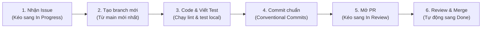

# Quy trình Làm việc Nhóm & Hướng dẫn Thực hiện Task (Team Workflow & Agile Guide)

> **Dự án**: BrewLite – Cashless Coffee Ordering System  
> **Học phần**: Công nghệ Phần mềm (Software Engineering) – Assignment 2  
> **Tài liệu**: WORKFLOW-VER-1.0  
> **Đối tượng áp dụng**: Tất cả thành viên trong nhóm phát triển  

---

## PHẦN 1: Mục đích của Bảng Issue (Product Backlog / Project Board)

Trong môn Công nghệ Phần mềm và mô hình Scrum/Agile thực tế, bảng Issue đóng vai trò là **"Trung tâm điều khiển"** của toàn bộ dự án:

1. **Minh bạch tiến độ (Transparency)**:
   * Giảng viên hoặc bất kỳ ai vào repository chỉ cần nhìn vào bảng Kanban là biết ngay: *Ai đang làm gì? Task nào đang bị tắc? Task nào đã hoàn thành? Sprint 1 đã xong được bao nhiêu %?*
   * Tránh tình trạng 2 thành viên vô tình làm trùng một tính năng hoặc đè code (conflict) lên nhau.
2. **Kiểm soát phạm vi Sprint (Sprint Scope)**:
   * Phân định rõ ràng: Những gì thuộc **Sprint 1** (nền tảng kỹ thuật, tài liệu, API menu và giao diện menu) phải xong trước, không được nhảy cóc sang làm các tính năng thanh toán hay giỏ hàng của **Sprint 2**.
3. **Phục vụ ma trận truy vết (Mục 8 đề bài - Traceability)**:
   * Mỗi Issue có mã yêu cầu nghiệp vụ tương ứng (`FR-01`, `FR-02`...). Khi viết code, commit và mở PR, việc gắn kèm mã Issue này giúp giảng viên truy vết được từ:  
     $$\text{Yêu cầu (SRS)} \longrightarrow \text{Issue} \longrightarrow \text{Pull Request} \longrightarrow \text{File mã nguồn} \longrightarrow \text{File kiểm thử}$$
4. **Tự động hóa với GitHub (Automation)**:
   * Khi mở PR và ghi cú pháp `Closes #<số_issue>`, ngay khi PR được merge vào nhánh chính, GitHub sẽ **tự động đóng Issue đó và chuyển thẻ công việc sang cột `Done`** mà không cần kéo thủ công.

---

## PHẦN 2: Sơ đồ Chu trình Phát triển Tính năng (Feature Workflow)

Từ Sprint 1 đến hết Sprint 2, toàn bộ thành viên nhóm tuân thủ nghiêm ngặt **vòng đời 6 bước chuẩn**:



---

## PHẦN 3: Chi tiết 6 Bước Thực hành Thực tế

*(Ví dụ minh họa: Thành viên nhận làm Task 4.3 – API Menu)*

### Bước 1: Nhận Task trên GitHub Projects
* Truy cập tab **Projects** trên repository GitHub ➔ Mở board `BrewLite - Product Backlog & Sprint Tracking`.
* Tìm thẻ công việc phân công cho bạn (ví dụ: `[TASK-4.3A] Backend: Hiện thực API GET /products`).
* Gán tên bạn vào mục **Assignees**.
* Kéo thẻ từ cột **`Todo`** sang cột **`In Progress`** (thông báo cho cả nhóm biết task đang được triển khai).

### Bước 2: Kéo code mới nhất và tạo Branch mới
Mở terminal tại thư mục gốc của repository trên máy tính:
```powershell
# 1. Chuyển về nhánh main và kéo các cập nhật mới nhất từ GitHub về
git checkout main
git pull origin main

# 2. Tạo và chuyển sang nhánh riêng cho tính năng của bạn
git checkout -b feat/task-4.3-menu-api
```
> **Quy ước đặt tên branch:**
> * Tính năng mới: `feat/<mã-task>-<tên-ngắn>` (vd: `feat/task-4.3-menu-api`)
> * Sửa lỗi: `fix/<mã-task>-<tên-ngắn>` (vd: `fix/task-5.1-cart-total`)
> * Tài liệu: `docs/<mã-task>-<tên-ngắn>` (vd: `docs/task-4.2-requirements`)

### Bước 3: Lập trình, Viết test và Tự kiểm tra (Local)
* Đọc kỹ các **Tiêu chí chấp nhận (Acceptance Criteria - AC)** được mô tả trong Issue.
* Viết mã nguồn trong thư mục tương ứng (`apps/api` hoặc `apps/web`).
* Viết Unit Test / Integration Test tương ứng cho tính năng vừa làm.
* **Trước khi commit, tự kiểm tra lại 100% bằng lệnh:**
  ```powershell
  # Kiểm tra lỗi cú pháp và linting
  npm run lint

  # Chạy toàn bộ test suites
  npm test
  ```

### Bước 4: Commit theo chuẩn Conventional Commits & Push lên GitHub
Đặt commit message theo đúng chuẩn quy định tại [`docs/conventions.md`](conventions.md):
```powershell
# 1. Thêm các file thay đổi vào staging
git add .

# 2. Commit với thông điệp rõ ràng, có gắn mã task và mã FR
git commit -m "feat(api): [FR-01] implement GET /products and database seed"

# 3. Đẩy nhánh lên GitHub
git push -u origin feat/task-4.3-menu-api
```

### Bước 5: Mở Pull Request (PR) trên GitHub
1. Vào repository trên GitHub, bạn sẽ thấy thông báo nhánh mới kèm nút **Compare & pull request** ➔ Bấm vào nút này.
2. Form mẫu PR (`pull_request_template.md`) sẽ tự động xuất hiện trong khung mô tả:
   * Điền dòng đầu: `Closes #<số_issue_của_task>` (ví dụ: `Closes #3`).
   * Tích chọn `[x]` vào các ô trong bảng tiêu chí Definition of Done (DoD).
3. Gán ít nhất 1 thành viên khác trong nhóm vào ô **Reviewers**.
4. Quay lại GitHub Projects, kéo thẻ công việc sang cột **`In Review / PR`**.
5. Chờ hệ thống **GitHub Actions CI** chạy tự động kiểm tra:
   * Nếu có dấu tích xanh ✅: Đủ điều kiện để review.
   * Nếu báo dấu đỏ ❌: Xem log lỗi, sửa lại code trên máy, commit và push lại để CI chạy lại.

### Bước 6: Review, Merge và Tự động hoàn thành (Done)
1. Thành viên được gán làm **Reviewer** nhận thông báo ➔ Vào xem tab **Files changed**.
2. Kiểm tra xem code có sạch sẽ, có test chưa và CI có xanh không.
3. Nếu đồng ý, reviewer bấm **Review changes** ➔ Chọn **Approve** ➔ Bấm **Submit review**.
4. Bấm **Squash and merge** (hoặc **Merge pull request**).
5. 🎉 **Hoàn tất:** GitHub sẽ tự động đóng Issue liên quan và chuyển thẻ công việc sang cột **`Done`** trên Project Board.

---

## PHẦN 4: Bảng Tóm tắt Lệnh Git Thường Dùng (Git Cheat Sheet)

| Mục đích | Lệnh thực thi |
| :--- | :--- |
| Cập nhật nhánh `main` mới nhất | `git checkout main && git pull origin main` |
| Tạo nhánh mới để làm việc | `git checkout -b <loại>/<tên-nhánh>` |
| Xem trạng thái các file đã sửa | `git status` |
| Xem chi tiết các dòng code thay đổi | `git diff` |
| Đưa toàn bộ thay đổi vào hàng đợi | `git add .` |
| Commit theo Conventional Commits | `git commit -m "<type>(<scope>): [<mã>] <tiêu đề>"` |
| Đẩy nhánh lên GitHub lần đầu | `git push -u origin <tên-nhánh>` |
| Đẩy các commit tiếp theo | `git push` |
| Xóa nhánh cục bộ sau khi đã merge | `git branch -d <tên-nhánh>` |

---

> [!NOTE]
> **Tài liệu tham khảo liên quan:**
> * Quy ước Commit & Definition of Done: [`docs/conventions.md`](conventions.md)
> * Hướng dẫn khởi chạy & Kiến trúc: [`README.md`](../README.md)
> * Ma trận truy vết yêu cầu: [`docs/traceability-matrix.md`](traceability-matrix.md)
